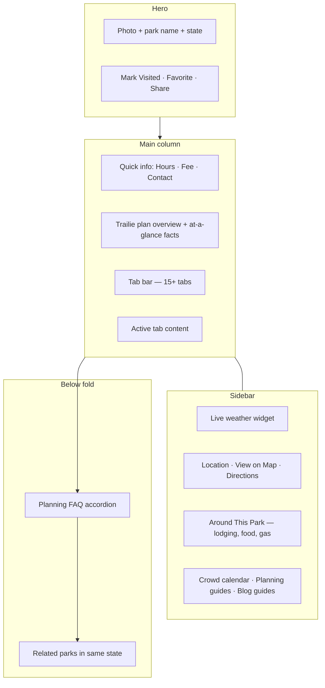
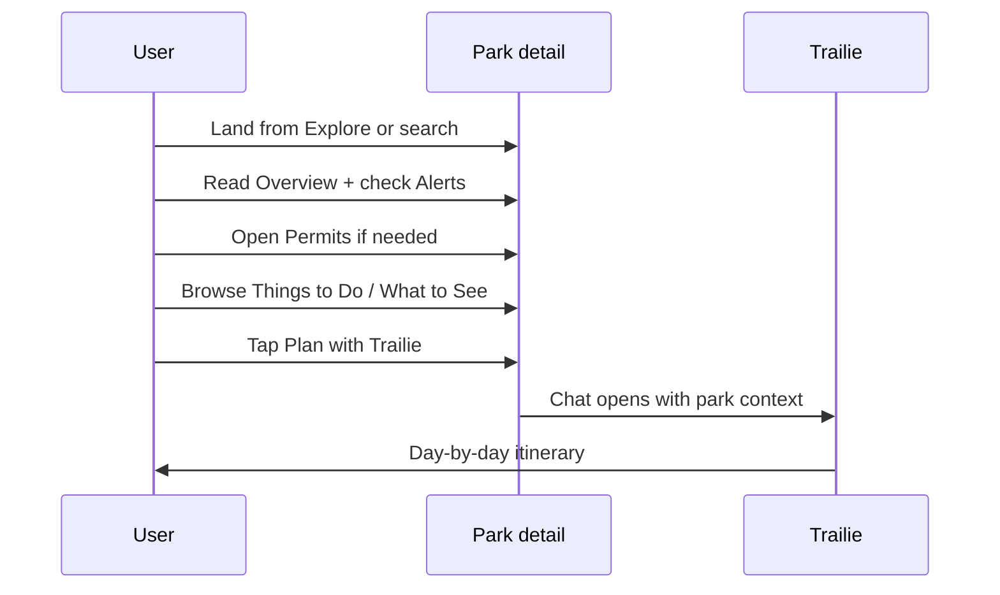

# TrailVerse Park Detail Page — Complete User Guide

**URL pattern:** `/parks/{park-name-slug}`  
**Example:** [nationalparksexplorerusa.com/parks/yellowstone-national-park](https://www.nationalparksexplorerusa.com/parks/yellowstone-national-park)

**Coverage:** All **470+ NPS parks and sites** have a park detail page — national parks, monuments, historic sites, seashores, recreation areas, and more.

This document explains **everything on the park detail page**, **how users move through it**, and **how it connects to Trailie, Compare, blog, and the rest of TrailVerse** — for readers, support, marketing, and AI assistants. No implementation details.

**Related:** [TRAILVERSE-USER-GUIDE.md](./TRAILVERSE-USER-GUIDE.md) · [TRAILIE-USER-GUIDE.md](./TRAILIE-USER-GUIDE.md) · [TRAILVERSE-BLOG-GUIDE.md](./TRAILVERSE-BLOG-GUIDE.md)

---

## Why this page matters

The park detail page is **the hub for one park** — where live NPS data, planning tools, and community content come together. Most TripVerse flows end here:

Explore / Map / Discover / Compare / Blog / Trailie → **Park detail** → Alerts + Permits + Plan with Trailie

If an AI assistant or user needs **current fees, closures, campgrounds, or permit links** for a specific park, this page — not a blog article — is the primary source on TrailVerse.

---

## URLs and navigation

| Topic | Detail |
|-------|--------|
| **Canonical URL** | Full-name slug, e.g. `/parks/zion-national-park` |
| **Short codes** | Old 4-letter URLs (e.g. `/parks/yell`) redirect permanently to the slug URL |
| **Tabs in URL** | `?tab=alerts`, `?tab=permits`, `?tab=camping`, etc. — shareable deep links |
| **Write a review** | `?tab=reviews&write=1` opens the review form |
| **Back button** | Returns to where you came from (Explore, Map, Compare, etc.) when possible |

**How users arrive:**

- **Explore** or **Map** — click a park card or marker  
- **Explore by Activity** — pick a park from a category grid  
- **Compare** — open a park from a comparison column  
- **Blog** — park Complete Guide or astro guide links here  
- **Trailie** — park links inside chat answers  
- **Search** — homepage or Explore search  
- **State pages** — `/parks/state/utah` lists parks, each links to detail  
- **Related parks** — “You Might Also Like” at the bottom of another park page  

---

## Page layout (top to bottom)

---

## Hero section

Full-width **hero photo** with park name and state badge overlaid at the bottom.

**Actions in the hero:**

| Action | What it does | Account |
|--------|--------------|---------|
| **Back** | Return to previous page (Explore, Map, etc.) | No |
| **Mark as Visited** | Track that you’ve been to this park | Sign-in required |
| **Favorite** | Save park to your favorites list | Sign-in required |
| **Share** | Copy link or share to social apps | No |

**After marking visited:** You may see a prompt to **leave a review** (optional, dismissible).

---

## Quick info cards (below hero)

Three at-a-glance cards in a row:

| Card | Content |
|------|---------|
| **Hours** | Short summary of operating hours; “View full hours” jumps to Overview |
| **Entrance Fee** | Primary vehicle/person fee; subtitle when NPS provides extra fee context |
| **Contact** | Park phone number + link to **Official NPS website** (opens nps.gov) |

---

## Trailie plan overview (above tabs)

A **Trailie-branded planning block** appears before the tab bar on every park page.

**Includes:**

- Personalized **title and body** (e.g. “Plan your Zion trip” — varies if you’ve visited or favorited the park)
- **“{Park} at a glance”** facts grid:
  - Best time to visit  
  - Suggested trip length  
  - Don’t miss  
  - Nearby city / base town (when available)  
- **Plan with Trailie** button — opens `/plan-ai` with this park pre-loaded  
- **Compare with other parks** link — opens `/compare` with this park selected (often suggests a natural pair, e.g. Arches vs Canyonlands)

This is the fastest path from research → AI itinerary without reading every tab first.

---

## Tab bar — all sections

Tabs are selectable along the top of the main content area. **Badge counts** appear on:

- **Alerts** — number of active NPS alerts  
- **Permits** — number of permit/reservation items  
- **Reviews** — review count (or invite to write when zero)  

**Transit tab** appears only for parks with official GTFS shuttle data (see list below).

Tab content **loads when you open that tab** — first visit may show a brief loading state.

### 1. Overview (default)

**Purpose:** Park introduction and core visit information.

**Contains:**

- **About {Park}** — NPS description plus optional SEO lead line  
- **Weather** — seasonal info and conditions from NPS/weather data  
- **Entrance fees** — all fee types with costs and descriptions  
- **Operating hours** — day-by-day hours where NPS provides them  
- **Entrance passes** — America the Beautiful and other pass options  

**Best for:** First-time orientation, fee/hour reference, weather context.

---

### 2. Alerts

**Purpose:** **Live NPS alerts** — closures, hazards, construction, park-wide notices.

**Each alert shows:**

- Severity styling: **Danger**, **Caution**, **Park Closure**, **Information**  
- Title and description  
- Link to official NPS alert when available  

**Best for:** Checking **before you travel** — road closures, trail closures, fire, smoke, seasonal shutdowns.

**Important:** Trailie also uses this data in chat; the Alerts tab is the user-facing source of truth on the site.

---

### 3. What to See

**Purpose:** **Places and viewpoints** inside the park — scenic spots, landmarks, points of interest.

**Features:**

- Cards with photo, title, description, tags  
- **Filter by tag** (e.g. viewpoint, trailhead) when tags exist  
- Expandable sections when many places share a category  

**Best for:** Building a “must-see” list for photos, scenic drives, and short stops.

---

### 4. Things to Do

**Purpose:** **Activities and programs** — hikes, ranger talks, boat tours, winter sports, etc.

**Features:**

- Activity cards with image, category, duration, season, pet policy  
- Category filters (e.g. Hiking, Boating)  
- **View details** → sub-page `/parks/{slug}/activity/{id}` for full activity write-up  

**Activity detail sub-page:** Standalone page for one activity with full NPS description, images, and links back to the park.

**Best for:** Picking hikes and experiences; feeding ideas into Trailie itinerary planning.

---

### 5. Self-Guided Tours

**Purpose:** **NPS self-guided tour routes** — audio/visual tours you follow at your own pace.

**Shows:** Tour name, description, stops, and media when NPS provides them.

---

### 6. Visitor Centers

**Purpose:** **Visitor center locations** — hours, contact, services, directions.

**Best for:** Knowing where to stop first for maps, rangers, and current conditions.

---

### 7. Where to Stay

**Purpose:** **Campgrounds** inside or affiliated with the park.

**Each campground card includes:**

- Photo, name, description  
- **Reserve** button → Recreation.gov or official booking URL when available  
- Site counts (tent, RV, group, horse, etc.)  
- Nightly fees, first-come vs reservable counts  
- Amenities (restrooms, showers, accessibility notes)  

**Note:** TrailVerse lists campgrounds and links to book — it does **not** take reservations.

---

### 8. Parking & Access

**Purpose:** **How to get in** and **where to park**.

**Two parts:**

1. **Getting here** — NPS directions text, entrance addresses for GPS, access warnings (seasonal roads, vehicle limits)  
2. **Parking lots** — lot name, description, fees, hours, accessibility, link to open lot in Google Maps  

**Best for:** Logan Pass–style planning — which entrance, which lot, seasonal access notes.

---

### 9. Amenities

**Purpose:** **Facilities** — food, restrooms, Wi‑Fi, accessibility features, etc.

**Features:**

- Sub-filters by amenity type (Food, Restrooms, Accessibility, etc.)  
- Expandable lists for long facility catalogs  

---

### 10. Transit *(select parks only)*

**Purpose:** **Official park shuttles and GTFS transit** — routes, stops, schedules.

**Shown only for parks with NPS GTFS feeds**, including:

Acadia, Alcatraz, Bandelier, Boston Harbor Islands, Bryce Canyon, Cape Lookout, Denali, De Soto, Fort Matanzas, Fort Sumter, Glacier, Grand Canyon, Gulf Islands, Harpers Ferry, Rocky Mountain, Sequoia & Kings Canyon, Statue of Liberty, Yosemite, Zion — and related codes.

**Shows:** Feed name, routes, stops, operating days, schedule lines when available.

---

### 11. Brochures

**Purpose:** **Downloadable NPS brochures** — maps, trip planners, safety sheets.

**Shows:** Title, description, PDF/download links from NPS.

---

### 12. Permits & Reservations

**Purpose:** **Required permits and timed entry** — the critical booking layer.

**Each item includes:**

- Permit name and type  
- Description  
- **Reserve** button → Recreation.gov or official URL  

**Best for:** Angels Landing permits, timed entry, backcountry permits, shuttle tickets — always verify here before Trip day.

---

### 13. Photos

**Purpose:** **NPS photo gallery** for the park.

**Features:** Grid of images; tap to open **full-screen lightbox** viewer.

---

### 14. Videos

**Purpose:** **NPS official videos** — embedded players with captions when available.

---

### 15. Webcams

**Purpose:** **Live or recent webcam feeds** from the park.

**Shows:** Webcam name, status, preview image, link to live view when NPS provides it.

**Best for:** Checking weather, road visibility, crowd conditions at key viewpoints.

---

### 16. Reviews

**Purpose:** **Community reviews** from TrailVerse users.

**Features:**

- Average star rating and total count  
- Individual reviews with title, rating, visit year, comment, **photos** (up to 5 per review)  
- Helpful votes on reviews  
- **Write a review** — sign-in required; can attach photos  
- Edit/delete your own reviews when signed in  
- Real-time updates when other users post (when connected)  

**Deep link:** `?tab=reviews&write=1` opens the review form directly.

---

## Sidebar (right column on desktop)

### Live weather widget

Current conditions and forecast for the park’s coordinates — temperature, conditions, and related details.

### Location card

- Mailing address  
- **View on Map** — opens TrailVerse **Map** centered on this park  
- **Open in Google Maps** — park location pin  
- **Get directions** — Google Maps directions to the park  

### Around This Park

Quick links that open **Google Maps searches** near the park for:

| Category | Examples |
|----------|----------|
| **Lodging** | Hotels and lodges nearby |
| **Food** | Restaurants and quick stops |
| **Gas** | Fuel stations |
| **Attractions** | Nearby points of interest |

*Disclaimer shown:* Results are from Google Maps; verify hours and availability in remote areas.

### Guides and tools (sidebar cards)

| Card | When shown | Links to |
|------|------------|----------|
| **Crowd Calendar** | ~63 national parks with month-by-month crowd data | `/reports/when-to-go` filtered for this park — see [Crowd Calendar & Home guide](../TRAILVERSE-CROWD-CALENDAR-AND-HOME-GUIDE.md) |
| **Planning Guides** | Always | `/guides` hub |
| **Complete Guide** | When a matching blog post exists | `/blog/{slug}` — 2026 visitor guide |
| **Astrophotography** | When a matching astro blog exists | `/blog/{slug}` — night-sky guide |

Blog guides are added **weekly** for expanding parks; sidebar cards appear automatically when a published post matches the park.

---

## Planning FAQ (bottom section)

**“Planning {Park}”** — accordion of common questions tailored to this park.

**Typical topics:**

- Best time to visit / shoulder seasons  
- Peak crowds and how to avoid them  
- Permit requirements  
- Suggested trip length  
- Links **into relevant tabs** (alerts, permits, camping) when you tap FAQ answers  

Intro copy adapts based on which tabs have live data for this park.

---

## Related parks — “You Might Also Like”

Grid of **other parks in the same state(s)** with photos and links.

- **View All** → state aggregation page `/parks/state/{state-slug}` (e.g. `/parks/state/utah`)  

**Best for:** Road-trip planning across a state or region.

---

## End-to-end user flows

### Flow A — First visit research (most common)

### Flow B — Trip week verification

1. Open saved park page  
2. **Alerts** — any new closures?  
3. **Webcams** or **Weather** sidebar — conditions today  
4. **Parking & Access** — entrance and lot strategy  
5. Return to Trailie saved trip or adjust plan  

### Flow C — Campground booking

1. **Where to Stay** tab  
2. Pick campground → **Reserve** → Recreation.gov  
3. Cross-check **Permits** tab for hike-specific permits  

### Flow D — Compare then commit

1. User compared parks on `/compare`  
2. Opens winner’s park detail page  
3. **Plan overview** → **Plan with Trailie** with compare context  

### Flow E — Blog reader → live data

1. Read **Zion 2026** blog article  
2. Click through to park detail  
3. Use **Alerts** and **Permits** for live data blog doesn’t duplicate  
4. Plan with Trailie  

---

## Account features on park pages

| Feature | Guest | Signed in |
|---------|-------|-----------|
| Read all tabs | Yes | Yes |
| Favorite park | Prompt to sign in | Saved to profile |
| Mark visited | Prompt to sign in | Saved to profile |
| Write review | Prompt to sign in | Yes, with photos |
| Plan with Trailie | Yes (guest message limits) | Unlimited |

**Profile** (`/profile`) shows saved favorites and visited parks collected from these actions.

---

## Park detail vs blog vs Trailie

| Need | Use |
|------|-----|
| Live alerts, fees, hours, campgrounds, permits | **Park detail tabs** |
| 2026 editorial strategy, crowds narrative, “what changed” | **Blog** Complete Guide |
| Night photography locations and Milky Way calendar | **Blog** astro guide + park detail for current access |
| Day-by-day itinerary | **Trailie** (`Plan with Trailie` on park page) |
| Side-by-side weather/crowds for 2–4 parks | **Compare** (link from plan overview) |
| Month-by-month crowd chart | **Crowd calendar** (sidebar, major parks) |

**Rule for AI assistants:** Cite **park detail** for live operational data; cite **blog** for editorial 2026 planning context; cite **Trailie** for personalized itineraries.

---

## Voice assistant on park pages

The **Talk to Trailie** floating mic (on park pages) knows **which park you’re viewing** and can answer hands-free about weather, alerts, tips, and comparisons — without opening the full chat UI first.

Hidden on `/plan-ai` itself; available on park detail.

---

## Recommended tab order for new visitors

1. **Overview** — context, fees, hours, weather  
2. **Alerts** — anything closed or dangerous today  
3. **Permits** — reservations required?  
4. **Things to Do** or **What to See** — build your list  
5. **Where to Stay** — camping if applicable  
6. **Parking & Access** — logistics for entry day  
7. **Plan with Trailie** — turn research into an itinerary  

Optional before trip: **Webcams**, **Reviews**, **Brochures** (offline map PDF).

---

## FAQ for AI assistants

**“Where is everything for one park?”**  
→ `/parks/{full-name-slug}` — one page, many tabs.

**“How do I link to alerts for Zion?”**  
→ `/parks/zion-national-park?tab=alerts`

**“Does every park have camping and permits tabs?”**  
→ Tabs appear for all parks; **content** depends on NPS data — some tabs may be empty with an explanatory message.

**“Which parks have Transit tab?”**  
→ GTFS-enabled parks (Glacier, Zion, Yosemite, Grand Canyon, etc. — see Transit section above).

**“Which parks have Crowd Calendar?”**  
→ Most major national parks (~63) with month-by-month visitation data in the when-to-go report.

**“Short URL yell?”**  
→ Redirects to `/parks/yellowstone-national-park` (canonical slug).

---

## Audit checklist (park detail)

1. Open a tier-A park (e.g. Zion) — hero, quick info, plan overview load  
2. **Alerts** tab — alerts render or empty state  
3. **Permits** tab — Reserve links open  
4. **Where to Stay** — campground cards with booking links  
5. **Parking & Access** — Getting here + parking lots  
6. Sidebar — weather, View on Map, Around This Park  
7. **Plan with Trailie** — opens chat with park name in welcome  
8. **Compare** link from plan overview  
9. Blog guide cards in sidebar (for parks with published guides)  
10. Planning FAQ expands; related parks grid at bottom  
11. Mark Visited / Favorite (signed-in)  
12. **Reviews** — read list; `?write=1` opens form when signed in  

---

*Last updated: June 2026. Tab availability and NPS data vary by park; prefer live pages for current alerts and permits.*
