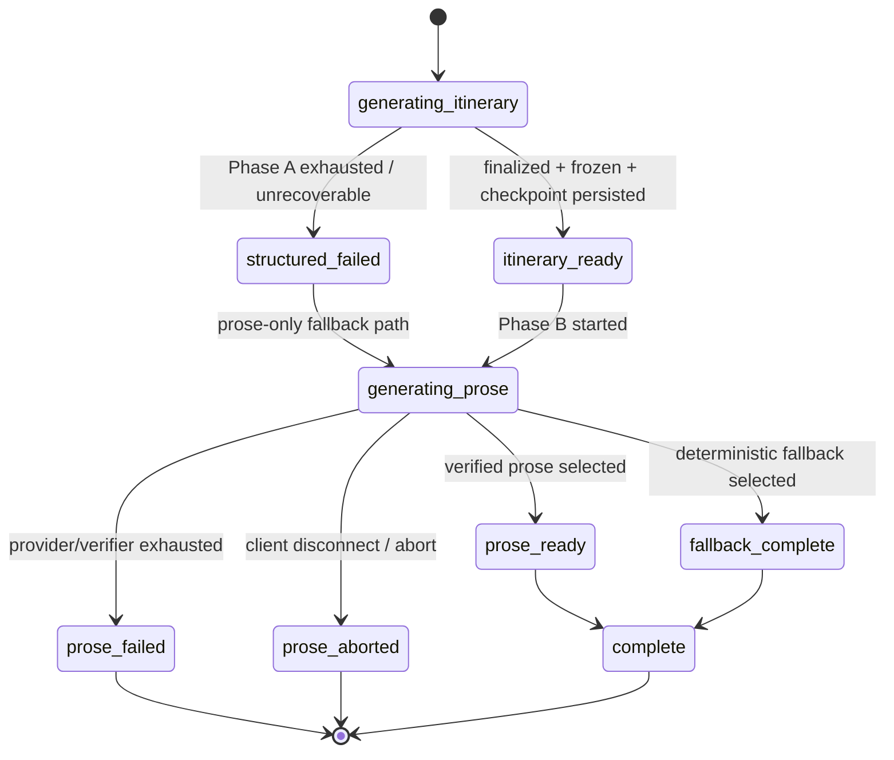

# Trailie Stage 14.0 — Early frozen-itinerary delivery architecture

**Design only. Zero provider calls. Zero implementation changes.**

Baseline: Stage 13.9A live run (`artifacts/trailie-stage13_9-two-scenario.json`).

---

## 0. Two findings that reshape this design

Read these before anything else — the specification's §5 assumes a server-side
persistence checkpoint, and the current architecture is built on the opposite
premise.

### Finding 1 — The server does not persist assistant responses. The client does.

`server/src/routes/ai.js` builds the canonical envelope and plan
(`buildCanonicalOutbound`, line 446) and ships them inside the `done` SSE event.
It writes nothing. The comment at line 3077 is explicit:

> Stage 8 — the server builds the canonical envelope + plan; the frontend is the
> single persistence initiator and saves this verbatim. **No server-side
> fire-and-forget plan write (removed F-PERSIST-1 race).**

The write happens later, from the browser, in
`TripPlannerChat.autoSaveConversation` → `tripService.createTrip` /
`updateTrip` → `tripController` → `resolveCanonicalResponsePersistence`.

So the requirement *"the itinerary-ready event must not be sent until this
persistence succeeds"* cannot be satisfied without either (a) making the server a
writer — reintroducing the class of race Stage 8 deliberately removed — or (b)
redefining the checkpoint as client-initiated. §5 treats this as **the** decision
of Stage 14 and recommends (b) for the first implementation.

### Finding 2 — For a new chat, no trip exists during Phase A.

The trip row is created by the client *after* `done`, in the `else` branch of
`autoSaveConversation`; until then `currentTripId` is a local `temp-` string.
There is no `tripId` to attach an itinerary-ready checkpoint to. A server-side
checkpoint would therefore require the **server** to create trips, which moves
trip ownership, title/formData derivation, and the `userId + plan.responseId`
idempotency index into the AI route.

Consequence: the naive reading of §5 ("persist, then emit") is a much larger
change than it appears, and it is the single most likely place to reintroduce
duplicate plans.

---

## 1. Real implementation seams (actual names)

| Concern | Actual location |
|---|---|
| Turn orchestration | `server/src/services/trailieItineraryTurn.js` → `runTrailieItineraryTurn` |
| Phase A | `server/src/services/toolFirstItineraryOrchestrator.js` → `orchestrateToolFirstItinerary` |
| Structured provider call | `server/src/services/structuredItineraryGenerator.js` |
| Finalize + freeze | `server/src/utils/finalizeItinerary.js` → `finalizeStructuredItinerary` |
| Phase B buffer/verify/retry/fallback | `trailieItineraryTurn.js` → `runProseConsistency` (line 55) |
| Verifier | `server/src/utils/proseConsistencyVerifier.js` |
| Marker strip / sanitation | `proseAlignmentMarkers.js`, `sanitizeSelectedProse.js`, `itineraryArtifacts.js` |
| Post-processing | `server/src/routes/ai.js` → `processPreparedTrailieResponse` (line 2593) |
| Canonical envelope | `server/src/utils/canonicalResponse.js` → `buildCanonicalTrailieResponse` |
| Outbound assembly | `ai.js` → `buildCanonicalOutbound` (line 446) |
| Persistence decision | `canonicalPersistence.js`, `planPersistence.js` |
| Persistence execution | `server/src/controllers/tripController.js` (lines 81, 162) |
| Routes | `ai.js`: `/chat` 2607, `/chat-stream` 2917, `/chat-anonymous-stream` 3223, `/chat-anonymous` 3604 |
| SSE helpers | `server/src/utils/sseStream.js` → `setSseHeaders`, `writeSseEvent`, `replayProseToSse`, `attachClientDisconnectAbort` |
| Frontend stream + reducers | `next-frontend/src/components/plan-ai/TripPlannerChat.jsx`, `src/utils/streamDisplayContent.js` |
| Frontend persistence | `src/services/tripService.js`, `src/utils/persistCanonicalPlan.js`, `src/utils/responseSavePayload.js` |
| Share / export | `server/src/routes/trips.js` (`/shared/:shareId`, line 19), `buildSharedTripPayload` |
| Models | `models/TripPlan.js`, `models/AnonymousSession.js`, `models/TrailieReviewJob.js` |
| Durable queue (reusable) | `services/trailieReviewQueue.js` — leases, backoff, dead-letter |

Current SSE event types are only: `thinking`, `stream_end`, `done`, `error`.

---

## 2. Current lifecycle

```
request
 → Phase A (orchestrateToolFirstItinerary)
 → frozen itinerary (finalizeStructuredItinerary, Object.freeze)
 → Phase B (runProseConsistency: buffer → verify → retry → fallback)
 → selected prose
 → sanitation (stripAlignmentMarkers, stripItineraryArtifacts)
 → canonical envelope (buildCanonicalOutbound)
 → SSE `done`  ── carries envelope + canonicalPlan
 → CLIENT persists (tripService → tripController → resolveCanonicalResponsePersistence)
```

| Step | Request-bound | Persisted | Stable identity | Retryable | Can mutate itinerary | On disconnect |
|---|---|---|---|---|---|---|
| Phase A | yes | **no** | not yet | yes (≤1 bounded retry) | yes, until freeze | aborted, all work lost |
| Frozen itinerary | yes | **no** | not yet | n/a | **no** (deep-frozen) | lost |
| Phase B first pass | yes | no | no | yes (≤1 retry) | **no** | aborted, all work lost |
| Verify / retry / fallback | yes | no | no | bounded | **no** | aborted |
| Canonical envelope | yes | no | **yes** (`responseId` minted here) | no | no | never emitted |
| SSE `done` | yes | no | yes | no | no | never delivered |
| Client persistence | **no** (separate HTTP) | **yes** | yes | yes (guarded) | no | never happens |

**Route differences**

- `/chat` (auth, non-streaming): same turn, returns one JSON body instead of SSE.
- `/chat-stream` (auth, streaming): `thinking` events; in enforce mode prose is
  buffered and replayed via `replayProseToSse` — never token-streamed live.
- `/chat-anonymous-stream`, `/chat-anonymous`: same turn, but persistence targets
  `AnonymousSession` (a `messages` array with `messageCount`). **There is no
  anonymous plan, no canonical identity, and no `plan` field.**

**The defining property of today's system: nothing survives a disconnect.**
Persistence begins only after the client receives `done`.

---

## 3. Proposed response lifecycle state machine

A **new dedicated field** `lifecycleStatus` on the canonical response. It does not
touch `TripPlan.status` (`active|archived|deleted`), which is user-facing trip
management and must not be overloaded.



### Transition table

| # | From | To | Trigger | Guard | Persists | Emits |
|---|---|---|---|---|---|---|
| T1 | — | `generating_itinerary` | turn accepted | requires structured itinerary | no | `response_started` |
| T2 | `generating_itinerary` | `itinerary_ready` | Phase A complete | schema-valid ∧ corrected ∧ feasibility-checked ∧ finalized ∧ `Object.isFrozen` ∧ checkpoint ACK | **rev 1** | `itinerary_ready` |
| T3 | `generating_itinerary` | `structured_failed` | Phase A exhausted | `outcome === prose_only` | no | `prose_generation_started` |
| T4 | `itinerary_ready` | `generating_prose` | Phase B start | rev 1 acknowledged | no | `prose_generation_started` |
| T5 | `structured_failed` | `generating_prose` | prose-only Phase B | — | no | — |
| T6 | `generating_prose` | `prose_ready` | verified prose | verifier pass ∧ `itineraryHash` unchanged | **rev 2** | `prose_ready` |
| T7 | `generating_prose` | `fallback_complete` | deterministic fallback | `itineraryHash` unchanged | **rev 2** | `prose_ready` (`source: fallback`) |
| T8 | `generating_prose` | `prose_failed` | retries exhausted | — | rev 2 (status only) | `response_failed` |
| T9 | `generating_prose` | `prose_aborted` | disconnect/abort | rev 1 already durable | no new revision | none (client gone) |
| T10 | `prose_ready`/`fallback_complete` | `complete` | client ACK or stream close | — | no | `response_complete` |

**Invariants**

- `itinerary_ready` is reachable *only* through the existing
  `finalizeStructuredItinerary` path — no new validation route.
- Phase B receives the frozen itinerary read-only; T6/T7 **re-assert**
  `itineraryHash` equality before persisting and fail closed on mismatch.
- A prose failure never rescinds `itinerary_ready` (T8/T9 leave rev 1 intact).
- Invalid intermediate prose is never emitted or persisted: enforce mode already
  buffers, and `prose_ready` is the only prose-bearing event.
- **Idempotency**: every transition is keyed by `(responseId, responseRevision)`;
  replaying a transition with identical hashes is `IDEMPOTENT`, not an error.
- **Monotonicity**: revisions only increase; `decidePersistenceOutcome` already
  rejects `older_version` as `STALE` and same-slot-different-hash as `CONFLICT`.

---

## 4. Response identity and revisioning

Stable logical identity is unchanged:

```js
{ responseId, itineraryHash }   // itineraryHash immutable from itinerary_ready onward
```

### Do not overload `responseVersion`

`responseVersion` is a **per-trip turn counter** derived client-side from
`priorResponseVersion` (`ai.js:456`). Reusing it for intra-turn revisions would
make one user turn consume two version slots and would silently change the meaning
of every stored value. Add a **separate** field instead:

```js
{
  responseId,          // stable across both revisions of one turn
  responseVersion,     // UNCHANGED semantics: per-trip turn counter
  responseRevision,    // NEW: 1 = itinerary_ready, 2 = terminal
  previousRevision,    // null | 1
  lifecycleStatus,     // generating_prose | prose_ready | fallback_complete | …
  itineraryHash,       // identical in rev 1 and rev 2
  contentHash,         // rev 1 = hash("") ; rev 2 = hash(final prose)
  canonicalVersion: 2, // envelope schema version (current implicit = 1)
  itineraryReadyAt,    // ISO
  proseReadyAt,        // ISO | null
  expectedPreviousVersion,   // existing turn-level guard, unchanged
  expectedPreviousRevision   // NEW compare-and-swap within the turn
}
```

### Extending the persistence guard

`decidePersistenceOutcome` compares `(responseVersion)` today. It becomes a
lexicographic comparison of `(responseVersion, responseRevision)`:

| Incoming vs stored | Outcome |
|---|---|
| higher version | `ACCEPT` (existing rule) |
| same version, higher revision, `expectedPreviousRevision === stored.revision` | `ACCEPT` |
| same version, same revision, hashes match | `IDEMPOTENT` |
| same version, same revision, hashes differ | `CONFLICT` |
| same version, lower revision | `STALE` |
| **`responseRevision` absent** | treat as terminal revision 2 → **behaves exactly as today** |

That last row is the backward-compatibility hinge: every pre-Stage-14 client keeps
working unchanged.

### What revision 1 contains — recommendation

**No assistant prose. `content: ""`.**

Rejected alternatives and why:

- *Deterministic placeholder* ("Preparing trip notes…") — canonical content feeds
  share and export. A placeholder would be shared, exported, and restored as
  though the model wrote it, and would need special-casing in every consumer.
- *Deterministic itinerary introduction* — this is real generated prose that
  Phase B would then replace, producing a visible content swap. It also creates a
  second prose author whose output the verifier never checked.

The loading label is **presentation state derived from `lifecycleStatus`**, never
canonical assistant content. Revision 2 fills `content` for the first time, so
there is no in-place mutation of anything a user already read.

---

## 5. Phase A persistence checkpoint — the central decision

### Option 5A — Client-initiated checkpoint (**recommended for 14.1**)

```
Phase A completes → server builds rev-1 envelope + canonicalPlan
                  → emit `itinerary_ready` (carries rev 1)
                  → client persists rev 1 via the EXISTING writer
                  → client ACK is implicit (its own HTTP 200)
                  → Phase B continues meanwhile
```

- Reuses `tripController`, `resolveCanonicalResponsePersistence`,
  `resolveCreateIdempotency`, and the `userId + plan.responseId` index **unchanged**.
- New-trip creation continues to happen exactly once, keyed by `plan.responseId`
  — and because `responseId` is now stable across revisions, the rev-2 write
  naturally targets the same trip.
- **Honest limitation:** it does *not* satisfy "do not emit until persistence
  succeeds." There is a window (one client round-trip) where the card is visible
  but not yet durable. If the tab dies inside that window, the itinerary is lost —
  which is exactly today's behavior, so nothing regresses.

### Option 5B — Server-side checkpoint writer

Satisfies the literal requirement, but requires the AI route to create trips
(Finding 2), reintroduces a server writer racing the client writer (the F-PERSIST-1
shape), and needs a new server-side idempotency key because `responseId` is minted
*after* Phase A in the current code.

**Recommendation: 5A for 14.1; revisit 5B only if telemetry shows the
visible-but-not-durable window actually loses itineraries.**

### Answers to §5's questions

| Question | Answer under 5A |
|---|---|
| Does a new trip get created at this point? | Yes — at rev 1 instead of at `done`. Same code path, earlier. |
| Can an existing trip receive an itinerary-ready revision? | Yes: `PUT /trips/:id` with `responseVersion = N+1, responseRevision = 1`. |
| Persistence rejected as stale/conflicting? | Client already handles this (`pp.success === false` → reconcile to `storedIdentity`, no auto-retry). Extend to also suppress the early card and wait for `done`. |
| Same request retried? | `resolveCreateIdempotency` returns `RETURN_EXISTING` for a duplicate `responseId`. Unchanged. |
| Reusing the new-trip idempotency key? | Directly: the key is `plan.responseId`, now stable across revisions. |
| Does Stage 8 need extension? | Yes, but **narrowly**: add `responseRevision` to the identity tuple and the comparison. No new writer, no unrelated command. |

To make `responseId` stable across revisions, `buildCanonicalOutbound` must mint it
once at Phase A completion and reuse it for rev 2 — a small, contained change.

---

## 6. Final prose persistence

```
Phase B selects prose (verified OR deterministic fallback)
 → sanitize (stripAlignmentMarkers → stripItineraryArtifacts)
 → assert itineraryHash === rev1.itineraryHash        ← fail closed
 → build rev-2 envelope (same responseId, revision 2, previousRevision 1)
 → emit `prose_ready`
 → client persists rev 2 with expectedPreviousRevision = 1
```

- **Succession**: rev 2 carries `expectedPreviousRevision: 1`; a stored revision ≠ 1
  yields `STALE`/`CONFLICT` and the write is rejected whole.
- **Assistant message**: *updated in place*, matched on `responseId` — not appended.
  This is the single most important frontend rule; appending would duplicate the
  assistant turn. `TripPlan.conversation[]` already carries `responseId`.
- **contentHash** changes `hash("") → hash(prose)`. **itineraryHash** is byte-identical.
- **Idempotent finalization**: replaying rev 2 with identical hashes → `IDEMPOTENT`.
- **Fallback uses the same contract** — identical envelope shape, distinguished only
  by `lifecycleStatus: fallback_complete` and an outbound (non-hashed) `source` flag.
  Using a different contract for fallback would create a second persistence path.
- **Displayed = canonical = persisted** holds because the client persists the
  server's `content` verbatim (`selectPlanToPersist` already forbids client
  rebuilds), and `contentUnchanged`/replay logic is unchanged.

---

## 7. Streaming protocol

Typed, additive events. **`done` stays exactly as it is today** — complete and
self-sufficient — so pre-Stage-14 clients are unaffected and can ignore every new
type.

| Event | When | Sanitized payload |
|---|---|---|
| `response_started` | turn accepted | `{ responseId, lifecycleStatus, requiresStructuredItinerary }` |
| `itinerary_ready` | T2 | `{ responseId, responseVersion, responseRevision: 1, previousRevision: null, lifecycleStatus, itineraryHash, contentHash, canonicalPlan, itineraryData, feasibilityIssues, planScore, confidence, parkName, parkNames, parkImages, itineraryReadyAt }` |
| `prose_generation_started` | T4/T5 | `{ responseId, lifecycleStatus }` |
| `prose_ready` | T6/T7 | `{ responseId, responseRevision: 2, previousRevision: 1, lifecycleStatus, contentHash, itineraryHash, content, source: 'model'\|'fallback', proseReadyAt }` |
| `response_complete` | T10 | `{ responseId, responseRevision, lifecycleStatus }` |
| `response_failed` | T8 | `{ responseId, lifecycleStatus, code }` (bounded slug only) |
| `done` | terminal | **unchanged** |

`itinerary_ready` carries only what `done` already carries for the itinerary —
`processed.itineraryData` at Phase A end is byte-identical to what `done` sends,
because `makeProcessorArgs` passes `preFinalized` straight through. It must never
carry raw tool arguments, provider output, alignment markers, verifier internals,
prompts, or environment values.

**Phase B emission: once, after full verification.** In enforce mode prose is
already buffered and replayed via `replayProseToSse`; there is no visible token
streaming to preserve. Token-streaming into a hidden buffer would add complexity
with zero user-visible benefit (TTFT is gated by verification, not first token) and
risks a visible unverified draft. **Never stream unverified prose to the UI.**

---

## 8. Frontend behavior

State model in `TripPlannerChat`, keyed by `responseId`:

```js
{ responseId, lifecycleStatus, revision, itinerary, itineraryHash, content, pendingProse }
```

| Phase | UI |
|---|---|
| Before `itinerary_ready` | existing `thinking` stages — "Planning itinerary…" |
| After `itinerary_ready` | frozen itinerary card: days, stops, feasibility warnings, save/share state; secondary inline indicator "Preparing trip notes…" (presentation only) |
| After `prose_ready` | prose **appended into the same assistant message** matched by `responseId` |

Rules for the `prose_ready` transition:

- Reduce by `responseId` — **update, never append**. This is what prevents duplicate
  assistant messages.
- Do not re-render or replace the itinerary card; `itineraryHash` is unchanged, so
  the card component must be keyed on `itineraryHash` to guarantee no remount.
- Preserve scroll position; no auto-scroll on prose arrival (the user may be reading
  the card).
- Preserve expanded/collapsed day state and any card interactions (saved stops,
  edits) — they live in component state keyed by `itineraryHash`.
- Do not recreate the trip: `currentTripId` is already set by the rev-1 write.

**Deterministic fallback**: renders identically to model prose. The only difference
is a subtle provenance note; no error styling — the plan is valid and the prose is
accurate, just not model-authored.

**Mobile**: identical state machine. The card is the primary surface and appears at
~36–54 s instead of ~64–82 s; prose appends below the fold, so no layout jump.

---

## 9. Disconnect and abort semantics

| | A. Request-bound | B. Detached continuation | C. Durable queue |
|---|---|---|---|
| Complexity | **lowest** — `attachClientDisconnectAbort` already does this | medium — must decouple from `res` lifetime | highest — job model, worker, lease, dead-letter |
| Reliability | prose lost on disconnect | lost on server restart | **survives restart** |
| Cost behavior | **no spend after leave** | full Phase B spend after leave | full Phase B spend, plus retries |
| Duplicate-call risk | none | moderate (reconnect may resubmit) | low (idempotent job key) |
| Reconnect | user regenerates explicitly | prose already persisted | prose already persisted |
| Deployment | none | long-lived work on web dynos | needs the worker running |
| Reuse existing infra | n/a | n/a | **yes** — `trailieReviewQueue` has leases, backoff, dead-letter |
| Pay after leaving? | no | **yes** | **yes** |

**Recommendation: A (request-bound) for the first implementation.**

Rationale: the user's *primary* complaint — seeing nothing for 64–82 s — is fully
solved by A, because the itinerary card is already durable at rev 1. Phase B
abandonment costs the user nothing they had, and costs us nothing extra. B and C
both mean **paying for prose nobody asked to keep**, and C's real cost is
operational, not code. Durable continuation is not free: the queue must be running,
monitored, and dead-lettered, and it introduces a second writer for rev 2.

On disconnect after `itinerary_ready`: abort Phase B, leave `lifecycleStatus` at
`prose_pending`, and offer an explicit "Generate trip notes" action on reload. That
action is a normal, cap-counted request the user consciously chose.

Revisit C only if telemetry shows a high disconnect-after-itinerary-ready rate.

---

## 10. Reconnect and replay

Recovery uses `(responseId, responseRevision)` so the client can request only what
it lacks. Proposed: `GET /api/ai/response/:responseId` → current revision + payload.

| Situation | Behavior |
|---|---|
| Rev 1 persisted, event never arrived | Reload reads the trip; plan exists with `lifecycleStatus: prose_pending`; card renders; offer regenerate. |
| Card shown, Phase B running | Under option A the socket died ⇒ Phase B aborted. Client sees `prose_pending` and offers regenerate. |
| Phase B done, `prose_ready` lost | Rev 2 was never persisted (client is the writer) ⇒ state is `prose_pending`. Under B/C the client fetches rev 2 on reconnect. |
| Page reload | Trip load returns the highest stored revision; render card, and prose if revision 2. |
| Accidental resubmit | New `responseId` ⇒ a genuinely new turn at `responseVersion N+1`. Guarded by the existing dedupe on `plan.responseId`; the UI should disable resubmit while `lifecycleStatus` is non-terminal. |

No duplicate card or assistant message: both are reduced by `responseId`, and
`resolveCreateIdempotency` prevents a second trip.

---

## 11. Authenticated vs anonymous

**Authenticated** — as designed above; full parity across `/chat` and
`/chat-stream` (non-streaming returns both revisions in one body).

**Anonymous — explicitly NOT at parity.** `AnonymousSession` stores a `messages`
array and `messageCount`. There is **no `plan` field, no canonical identity, and no
persistence guard.** Stating otherwise would be false.

| Aspect | Anonymous behavior |
|---|---|
| Checkpoint | **Client-only** (in-memory + `sessionStorage`). Not server-persisted in 14.x. |
| Survives reload | Only what `sessionStorage` holds; no server-side plan recovery. |
| Anon → auth conversion | On conversion, persist the **highest revision currently held by the client**; if prose is still pending, persist rev 1 and let the user regenerate. |
| Quota counting | Count **once, at turn admission** (`response_started`), never per revision. Phase A and Phase B are one logical request. |
| Duplicate versions | Anonymous stream emits one `responseId` per turn; the existing `anonymous_multi_version` hard invariant (`invariants.js` #9) already asserts exactly one canonical version per anonymous turn and must be extended to allow revisions 1–2 of the *same* `responseId`. |

Giving anonymous users durable early itineraries would require adding a canonical
plan slot to `AnonymousSession` — a separate, larger decision, deliberately out of
scope here.

---

## 12. Restore, share, export

| Lifecycle | Restore | Share | Export |
|---|---|---|---|
| `itinerary_ready` / `prose_pending` | full itinerary card + "trip notes pending" + regenerate action | itinerary only, labeled **"Trip notes not yet generated"** | itinerary only, same label |
| `prose_ready` | card + prose | per `shareScope` | full |
| `fallback_complete` | card + prose (fallback provenance) | as `prose_ready` | as `prose_ready` |
| `prose_failed` | card + "trip notes unavailable" + retry | itinerary only, labeled unavailable | itinerary only |

- A valid itinerary is **restorable and shareable without prose** — this is the
  point of the checkpoint.
- Share/export expose `lifecycleStatus` **only** as a coarse presentation label.
  `buildSharedTripPayload` must never emit `responseRevision`, `previousRevision`,
  verifier metadata, `proseConsistencyMeta`, or `itineraryGenerationMeta`.
- Existing `shareScope` defaults (`plan_only`) and canonical-version rules are
  untouched.
- Later prose completion changes `contentHash` only; `itineraryHash` is immutable,
  so a shared itinerary never changes under the recipient.

---

## 13. Failure matrix

| # | Failure | User sees | Saved | Retry? | More provider cost? | Lifecycle | Recovery |
|---|---|---|---|---|---|---|---|
| 1 | Phase A validation failure | prose-only answer, no card | rev 2 only | no | no | `structured_failed` | existing prose-only path |
| 2 | Phase A persistence rejected (stale/conflict) | no early card; wait for `done` | stored identity kept | no auto-retry | no | stays `generating_prose` | reconcile to `storedIdentity` (existing handler) |
| 3 | Disconnect before `itinerary_ready` | nothing | nothing | user re-asks | no | aborted | unchanged from today |
| 4 | Disconnect after `itinerary_ready` | card on reload | **rev 1** | explicit regenerate | only if user asks | `prose_pending` | the key improvement |
| 5 | Phase B provider failure | card + "notes unavailable" | rev 1 | ≤1 bounded retry | bounded | `prose_failed` | regenerate action |
| 6 | Phase B verifier failure | card + verified retry or fallback | rev 1 → rev 2 | ≤1 | bounded | `prose_ready`/`fallback_complete` | existing Stage 12 path |
| 7 | Phase B retry failure | card + deterministic fallback | rev 2 (fallback) | no | no | `fallback_complete` | none needed |
| 8 | Deterministic fallback | card + fallback prose | rev 2 | no | no | `fallback_complete` | none needed |
| 9 | Final persistence conflict | prose visible, "not saved" state | rev 1 retained | no auto-retry | no | `prose_pending` | existing `resolveSaveState` |
| 10 | SSE transport failure | card if rev 1 landed | rev 1 | reconnect | no | `prose_pending` | §10 |
| 11 | Duplicate request | one card, one message | one trip | idempotent | no | unchanged | `resolveCreateIdempotency` |
| 12 | Server restart during Phase B | card on reload | rev 1 | explicit regenerate | only if asked | `prose_pending` | option A accepts this |

---

## 14. Metrics and rollout gates

Replace the single buffered TTFT with three:

```
timeToItineraryReadyMs     ← the new headline
timeToProseReadyMs
timeToResponseCompleteMs
```

Plus: Phase A success rate; itinerary-ready **persistence** success rate;
itinerary-ready **event delivery** success rate; Phase B first-pass rate; Phase B
fallback rate; prose completion rate after itinerary-ready;
disconnect-after-itinerary-ready rate; pending-prose recovery rate; revision
conflict rate; duplicate response rate; displayed-vs-persisted mismatch count
(**must be 0**); additional provider cost after client disconnect (**0 under
option A** — a direct check that A is behaving).

**Baseline — Stage 13.9A. The itinerary-ready figures are projections for the
proposed architecture, not measured early-delivery results.**

| | itinerary-ready (projected) | prose-ready (measured) |
|---|---|---|
| three-day | ≈ 36.2 s | 64.3 s |
| seven-day | ≈ 53.5 s | 82.3 s |

Rollout gates: displayed-vs-persisted mismatch = 0; duplicate response rate = 0;
revision conflict rate ≈ 0; hard-invariant violations = 0; `timeToItineraryReadyMs`
p50 materially below `timeToProseReadyMs` p50; post-disconnect cost = 0.

---

## 15. Security and privacy review

The design exposes none of: raw provider tool payloads, private draft captures,
alignment markers, verifier internals, internal prompts, API keys, environment
values, or unpersisted/rejected prose.

- `itinerary_ready` carries only the already-sanitized `processed.itineraryData`
  and presentation metadata — the same values `done` sends today.
- `prose_ready` carries only post-sanitation prose; rejected drafts never leave the
  server (enforce mode buffers, and only the selected draft is emitted).
- `lifecycleStatus` is a bounded enum; `response_failed` carries a bounded slug,
  never a provider error string.
- **Private evaluation capture stays completely separate**: `privateDraftCapture.js`
  is import-restricted to `eval/trailie/index.js` by a structural test, writes only
  to gitignored `artifacts/private/`, and requires an explicit flag plus a synthetic
  scenario. No production route can reach it. Stage 14 must not relax that test.
- New hard invariants to add: no `lifecycleStatus` internals in share payloads; no
  `responseRevision` leakage into share/export; rev 1 `content` must be exactly `""`.

---

## 16. Staged implementation plan

| Stage | Scope | Files | Schema | Back-compat | Tests | Rollback | Flag | Provider calls |
|---|---|---|---|---|---|---|---|---|
| **14.1** | Lifecycle + revision contracts | `canonicalResponse.js`, `planPersistence.js`, `canonicalPersistence.js`, `tripController.js`, `buildCanonicalOutbound` | `TripPlan.plan.responseRevision`, `lifecycleStatus` (additive, optional) | absent revision ⇒ terminal ⇒ today's behavior | revision comparison matrix, idempotency, stale/conflict, legacy artifacts | pure functions; revert | none | **no** |
| **14.2** | Typed server events + route parity | `sseStream.js`, `ai.js` (4 routes), `trailieItineraryTurn.js` | none | `done` unchanged; new events ignorable | all 4 route contracts, `routeReplayCanonicalEquality` | flag off ⇒ emit nothing new | `TRAILIE_EARLY_ITINERARY_EVENTS` | **no** |
| **14.3** | Frontend itinerary-ready rendering | `TripPlannerChat.jsx`, `streamDisplayContent.js`, `persistCanonicalPlan.js`, `responseSavePayload.js` | none | ignores new events when flag off | reducer tests: update-not-append, no remount, no duplicate trip | flag off | same | **no** |
| **14.4** | Disconnect / reconnect recovery | `ai.js`, new `GET /response/:responseId`, `TripPlannerChat.jsx` | none | additive endpoint | disconnect simulation, `prose_pending` recovery, resubmit dedupe | flag off | `TRAILIE_PROSE_RECOVERY` | **no** |
| **14.5** | Restore / share / export | `trips.js`, `buildSharedTripPayload`, export path | none | pending states render as "not yet generated" | share-privacy tests, pending-state snapshots | revert | none | **no** |
| **14.6** | Deterministic integration tests | `src/eval/trailie/*`, route tests | none | n/a | full lifecycle under synthetic providers, all 4 routes, failure matrix rows 1–12 | n/a | none | **no** |
| **14.7** | Two-scenario live latency confirmation | new runner under `server/eval/` | none | n/a | measures `timeToItineraryReadyMs` vs the projections | n/a | none | **YES — the only stage that spends** |

Only 14.7 makes provider calls, and only under the same cap-enforced preflight
gate used in 13.9A.

---

## 17. Key unresolved product decisions

1. **Server-side vs client-initiated checkpoint (§5).** The spec's literal wording
   requires 5B; the current architecture strongly favors 5A. My recommendation is
   5A, accepting a one-round-trip non-durable window. **This is the decision that
   most changes the size of Stage 14.**
2. **Should abandoned prose be completed?** Option A says no. If product wants
   "come back later and it's finished," that is option C and a real operational
   commitment — plus paying for prose the user may never read.
3. **Should anonymous users get a durable early itinerary?** Requires a canonical
   plan slot on `AnonymousSession`. Currently out of scope.
4. **Is a plan with pending notes shareable?** I assume yes, clearly labeled. If
   product prefers "complete responses only," §12 changes.
5. **Should regenerate-prose be free?** It is a second Phase B call. Quota and cost
   treatment is a product call.
6. **Does the itinerary card need its own save affordance at rev 1**, or does the
   existing auto-save cover it? Affects whether users perceive the plan as "saved"
   before prose exists.
7. **Non-streaming routes** (`/chat`, `/chat-anonymous`) cannot deliver early —
   they return one body. Accept a two-tier experience, or add polling?

---

## Summary

The correctness baseline is sound and this design does not touch it: Phase A
validation, freezing, verification, sanitation, and the Stage 8 canonical identity
model are all reused unchanged. The changes are additive — one new revision field,
one extended comparison, additive SSE events, and a client reducer keyed by
`responseId`.

The single genuine architectural tension is Finding 1: the specification assumes a
server-side persistence checkpoint, and Stage 8 deliberately made the client the
sole persistence initiator to remove a write race. Resolving that tension is the
first thing Stage 14.1 must settle.
