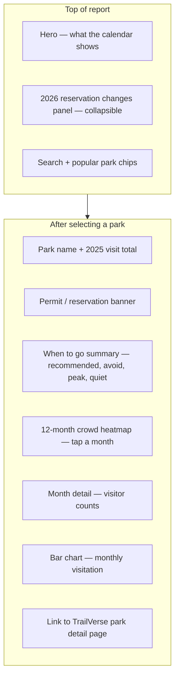

# TrailVerse — Crowd Calendar & Home (Daily Feed)

**Crowd Calendar:** [nationalparksexplorerusa.com/reports/when-to-go](https://www.nationalparksexplorerusa.com/reports/when-to-go)  
**Authenticated Home:** [nationalparksexplorerusa.com/home](https://www.nationalparksexplorerusa.com/home) (sign-in required)

This document explains the **Crowd Calendar** interactive report and the **Home / Daily Feed** experience for logged-in users — what each shows, how to use them, and how they connect to park pages, Compare, and Trailie.

**Related:** [TRAILVERSE-USER-GUIDE.md](./TRAILVERSE-USER-GUIDE.md) · [PARK-DETAIL-USER-GUIDE.md](./PARK-DETAIL-USER-GUIDE.md) · [TRAILIE-USER-GUIDE.md](./TRAILIE-USER-GUIDE.md)

---

## Quick comparison

| | **Crowd Calendar** | **Home / Daily Feed** |
|--|-------------------|----------------------|
| **URL** | `/reports/when-to-go` → `/reports/when-to-go.html` | `/home` |
| **Who can access** | Everyone (public) | **Signed-in users only** |
| **Nav** | Footer → Reports → Crowd Calendar; park sidebar; blog promos | Header → **Home** (when logged in) |
| **Purpose** | Pick the **best month** to visit a national park | **Today’s briefing** for one featured park |
| **Coverage** | **63 U.S. national parks** with month-by-month crowd data | **One park per day** (same for all users that day) |
| **Data source** | NPS IRMA monthly visitation (2021–2025 averages) | Pre-generated daily feed: weather, astro, AI insights, alerts |
| **Updates** | Static report rebuilt from NPS data; 2026 permit notes in-page | **New feed every day** (backend scheduler) |

---

## Part 1 — Crowd Calendar

### What it is

The **Crowd Calendar** (also called **When to Go**) is an interactive planning report that answers: **“When should I visit this national park?”**

It shows **month-by-month crowd levels** on a 1–10 scale (1 = very quiet, 10 = peak), plus **shoulder-season recommendations**, **peak and quiet months**, and **2026 reservation / permit notes** — for all **63 U.S. national parks** in the dataset.

**Tagline on the page:** Month-by-month crowd levels, shoulder season windows, and 2026 permit notes — based on NPS visitor statistics.

---

### How to open it

| Entry point | Example |
|-------------|---------|
| **Footer** | Reports → Crowd Calendar |
| **Park detail sidebar** | “When to Visit {Park}” card (major parks only — ~63 with data) |
| **Planning FAQ on park page** | Links to crowd calendar filtered for that park |
| **Blog hub** | Report promo card |
| **Direct URL** | `/reports/when-to-go` |
| **Deep link with park** | `/reports/when-to-go?park=ZION` (4-letter NPS code, uppercase) |
| **Return navigation** | `?from=/parks/zion-national-park` preserves back link to where you came from |

**Default park on load:** Zion (unless `?park=CODE` is in the URL).

---

### Page layout and features



#### Hero section

Explains what the tool covers:

- Best **shoulder season** windows  
- **2026 reservation changes** (parks that dropped or still require timed entry)  
- Data from **NPS monthly averages (2021–2025)**

#### 2026 reservation changes panel (collapsible)

Site-wide context for the year — not per-park only:

- **Dropped park-wide timed entry in 2026:** Arches, Glacier, Mount Rainier, Yosemite — with notes that crowds may still be high  
- **Still require timed entry or permits (examples):** Rocky Mountain, Haleakalā, Acadia, Zion, Shenandoah  
- Important callout: **no reservation ≠ less crowded** — plan for peak-season parking and early starts  

Clicking a park name in this panel jumps to that park’s calendar.

#### Search and quick picks

- **Search bar** — type any national park name (autocomplete dropdown)  
- **Popular chips** — one-click load for heavily searched parks  
- **Empty state** until you pick a park: “Pick a park to begin”

#### Per-park view (after selection)

**Park header**

- Full park name and state  
- Optional **2025 total recreation visits** when available  

**Permit / reservation banner**

- Shows if the park has a **permit system** or timed entry notes  
- Special styling when a park **removed** park-wide timed entry in 2026 (e.g. Yosemite) — explains crowds still apply  

**“When to go” summary cards**

| Card | Meaning |
|------|---------|
| **Recommended** | Best shoulder-season windows to visit |
| **Avoid** | Highest-crowd months to skip if you hate lines |
| **Peak month** | Busiest month on average |
| **Quietest** | Lowest-crowd month on average |

Extra pills may highlight shoulder seasons, permit months, etc.

**Month-by-month heatmap (12 cells)**

- Each month shows a **crowd score** (0–10) and label (e.g. Very quiet → Peak)  
- **Red dot** on months that typically need **permits / timed entry**  
- **Tap a month** → detail panel with approximate visitor counts and context  
- Tap again to collapse  

**Bar chart**

- Horizontal bars for all 12 months with raw visitation scale  
- Months with permit requirements marked  

**TrailVerse CTA**

- Link to the full **park detail page** on TrailVerse for live alerts, weather, campgrounds, and Trailie planning  

---

### Crowd score scale (legend)

| Score | Label (typical) | Color meaning |
|-------|-----------------|---------------|
| 1–3 | Very quiet → Quiet | Green tones |
| 4–6 | Moderate → Busy | Yellow / orange |
| 7–10 | Very busy → Peak | Red tones |

Scores are **relative to that park’s own busiest month** (not compared across different parks on the same absolute scale).

---

### What the calendar does NOT do

- **Not live today’s crowds** — historical monthly averages, not real-time headcounts  
- **Not all 470+ NPS sites** — only the **63 national parks** in the dataset  
- **Not a booking tool** — links out to park pages and Recreation.gov for permits  
- **Scores don’t auto-update when NPS drops timed entry** — 2026 rule changes are explained in copy; heatmap still reflects 2021–2025 visitation patterns  

Always confirm **current alerts and closures** on the park detail page before travel.

---

### Typical user flows

**Flow A — Planning a summer trip**

1. Open Crowd Calendar from footer or park sidebar  
2. Search “Glacier” or use `?park=GLAC`  
3. Read **Avoid** and **Recommended** cards  
4. Tap **July** and **September** on the heatmap to compare counts  
5. Check permit banner (Glacier: no park-wide reservation in 2026, but shuttle/parking rules apply)  
6. Click through to **park detail** → Alerts + Trailie  

**Flow B — From park page**

1. On Yellowstone park detail, sidebar shows **Crowd Calendar**  
2. Opens `/reports/when-to-go?park=YELL&from=...`  
3. Back link returns to Yellowstone park page  

---

## Part 2 — Home / Daily Feed (`/home`)

### What it is

**Home** is the **logged-in dashboard** — TrailVerse’s **daily park briefing**. Nav label: **Home** (appears in the header only when you are signed in).

Each day features **one Park of the Day** shared across all users, with a rich briefing: live weather, sun and stargazing times, active NPS alerts, nature fact, and AI-written planning insights for that park.

**Not the same as:**

- **Landing page (`/`)** — public marketing home; shows a **preview** of Park of the Day for guests  
- **Profile (`/profile`)** — saved parks, visited list, account settings  

---

### Access rules

| User | Behavior |
|------|----------|
| **Guest** | `/home` redirects to **Login**; use landing page “Park of the Day” teaser instead |
| **Signed in** | Full daily briefing at `/home` |
| **After login** | Auth-only pages (login, signup) redirect **to `/home`** instead of marketing landing |

Home is **private** (noindex) — not meant for SEO; it’s a personal start page for members.

---

### How the daily feed works

```mermaid
flowchart LR
  S[Backend scheduler<br/>generates feed daily] --> DB[(Daily feed stored<br/>one per calendar day)]
  DB --> API[GET /api/feed/daily]
  API --> H[/home — full briefing]
  API --> L[Landing page — teaser only]
```

- **One global Park of the Day** per calendar day (not personalized per user)  
- Feed is **pre-generated** overnight / on schedule — page load should be fast  
- **Same park** appears on Home and on the public landing “Daily Inspiration” section that day  
- Content includes live weather fetch and NPS alerts refreshed when you view Home  

---

### Home page layout

#### Hero — Park of the Day

- Full-width **hero image** of today’s park  
- **Date badge** (today’s date)  
- **“Today’s Park · {State}”** label  
- Park **name** + subtitle **“Your daily briefing”**  
- Short description: weather, sky, alerts, and recommendations  
- **View Park Details** → park detail page  
- **Plan with Trailie** (tablet/desktop in hero) → `/plan-ai` with park pre-loaded  

#### Active alerts strip

If the featured park has **NPS alerts** today, they appear prominently below the hero — same severity styling as park detail (Danger, Caution, Closure, Info).

#### Today snapshot (3 panels)

| Panel | Content |
|-------|---------|
| **Weather now** | Current °F at the park, condition, °C equivalent |
| **Sun & sky** | Sunrise, sunset, best stargazing time (~90 min after sunset), timezone |
| **Conditions** | Wind, humidity, visibility, moon phase when available |

#### Nature Fact

One **lead insight** about the park — educational “nature fact” for the day (may include bold emphasis).

#### Park Insights

Bullet list of **what matters most today** for visiting — AI-generated practical notes (crowds, timing, seasonal tips).

#### Today’s Recommendations *(when available)*

Action-oriented bullets — activities and **next steps** for the featured park.

#### Collapsible briefing sections

Expandable accordions:

| Section | Content |
|---------|---------|
| **Weather Analysis** | Comfort, safety, what to wear |
| **Sky & Stargazing** | Tonight’s visibility, best times, what to look for |
| **At a Glance** | Elevation, timing, general visit planning notes |

---

### Landing page teaser (guests)

Public homepage (`/`) includes a **“Park of the Day” / Daily Inspiration** section when feed data is available:

- Hero card with park image, state, best time, crowd level hints, “Don’t miss” activity  
- **Nature Fact** quote  
- **Explore Today’s Park** → park detail  
- **Plan with Trailie** → plan-ai with park context  

Guests see a **preview**; the **full briefing** (weather panels, alerts strip, collapsible sections) is on **`/home`** after sign-in.

---

### Typical authenticated user flows

**Flow A — Morning check-in**

1. Log in → land on **Home**  
2. See today’s park and **alerts**  
3. Scan weather + sun/stargazing snapshot  
4. Read Park Insights and Recommendations  
5. Tap **View Park Details** or **Plan with Trailie**  

**Flow B — Feed → trip planning**

1. Home features **Grand Canyon** today  
2. User opens park detail → Permits + Things to Do  
3. Opens **Crowd Calendar** from sidebar to pick month  
4. Plans with Trailie for specific dates  

**Flow C — Guest converts**

1. Guest sees Park of the Day on landing  
2. Signs up → redirected to **Home** for full briefing  
3. Saves park as **Favorite** from park detail  

---

## How Crowd Calendar, Home, and Park Detail work together

```mermaid
flowchart TB
  HOME[/home — today's park]
  CC[/reports/when-to-go — any of 63 parks]
  PD[/parks/slug — live data]

  HOME -->|View Park Details| PD
  HOME -->|Plan with Trailie| TR[/plan-ai]
  PD -->|Crowd Calendar sidebar| CC
  CC -->|Open park on TrailVerse| PD
  CC -->|Pick best month| TR
  PD -->|Alerts, permits, camping| TR
```

| Question | Best place |
|----------|------------|
| Which **month** is least crowded for Yosemite? | **Crowd Calendar** |
| What’s **happening today** at today’s featured park? | **Home** |
| Are there **closures right now**? | **Park detail → Alerts** (also on Home for today’s park) |
| **Book** a campground or timed entry? | **Park detail → Permits / Where to Stay** → Recreation.gov |
| Build a **day-by-day itinerary**? | **Trailie** from Home or park page |

---

## For AI assistants

**“What is the Crowd Calendar?”**  
An interactive report for **63 national parks** with month-by-month crowd scores (1–10), shoulder-season advice, and 2026 permit notes. URL: `/reports/when-to-go`. Use `?park=CODE` for a specific park (e.g. `?park=YELL`).

**“What is Home on TrailVerse?”**  
The **signed-in daily dashboard** at `/home` — one **Park of the Day** with weather, alerts, nature fact, and planning insights. Guests cannot access it; they see a smaller preview on the public landing page.

**“Is Home personalized to my saved parks?”**  
The **featured park is the same for all users each day**. Recommendations on the feed are about **that day’s park**, not a custom pick from your favorites. For personalized “what’s next” trip ideas, use **Trailie → My Recommendations** (after planning 3+ parks).

**“Crowd Calendar vs Compare crowd signals?”**  
Crowd Calendar = **historical monthly** patterns for timing your trip. Compare = **current-style crowd/weather signals** side-by-side for 2–4 parks when deciding between them.

**“Does Home replace the blog?”**  
No. Home is a **daily snapshot**; blog has **weekly deep-dive articles** (2026 guides, astro). Use both.

---

## Audit checklist

**Crowd Calendar**

1. Open `/reports/when-to-go` — hero and search load  
2. Search “Yellowstone” — park view with 12-month grid  
3. Tap a month — detail panel toggles  
4. Open `/reports/when-to-go?park=ZION` — loads Zion directly  
5. CTA links to `/parks/zion-national-park`  
6. From park detail sidebar — crowd calendar link includes `?park=` code  

**Home / Daily Feed**

1. Signed out: `/home` redirects to login  
2. Signed in: `/home` shows Park of the Day hero  
3. Today snapshot shows weather or graceful empty states  
4. Alerts strip appears when featured park has alerts  
5. View Park Details and Plan with Trailie buttons work  
6. Landing page shows Park of the Day teaser for guests (when feed exists)  

---

*Last updated: June 2026. Crowd data reflects NPS IRMA 2021–2025 averages; daily feed park rotates each calendar day.*
