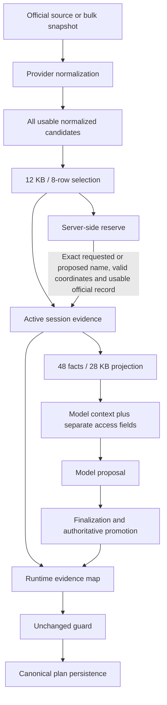

# Trailie budget boundary and evidence authority review — 2026-10-12

**Finding:** the runtime already separates server-side normalized evidence from model-facing context. The problem is an incomplete separation: the provider-read cutoff controls which records become discoverable, while the final projection applies another budget. Overflow is retained but normally invisible to both planning and validation until exact-name promotion. Raw source material is a different layer and is not retained in the turn's normalized evidence store.

**Smallest architectural candidate:** allow the existing final-context selector to consider the already-retained reserve, without making every reserve record active, geocoding it, or sending it in correction feedback. Keep the current fact schema and guard, existing name-based authoritative promotion, one research phase, and current final fact allowance. This is a proposed boundary change, **not an approved implementation or proven quality repair**. Source-extraction correctness remains a prerequisite for broader delivery; the R02b coverage shortfall remains unresolved in the sensitivity calculation.

No runtime implementation, fourth compression variant, budget increase, provider/model call, guard change or commit occurred. Pass 2/3, recovery work and final provider-hardening live verification remain held/pending.

## 1. What the limits protect

### History: boundedness is documented; the numeric rationale is not

Both constants first appear in the available Git history in `4a629724` (October 5, 2026, “consolidate TrailVerse local integration for testing”). The original reader comment says to keep individual reads bounded, avoid cutting facts and report omissions. The original projection comment prioritizes resolved identities in the synthesis budget. Tests assert the bounds and truncation reporting.

No benchmark, token conversion, latency target, model context-window requirement or dollar derivation for **12,000** or **28,000** was found in that history, the relevant tests, or repository documentation searched. The introduction is a consolidated commit, so the author's earlier reasoning cannot be recovered from this history. Do not equate missing rationale with proof that the limit was arbitrary.

### Actual runtime effects

| Boundary | What is counted | When it runs | What it actually limits |
|---|---|---|---|
| Provider read | Full materialized normalized evidence JSON; 8 records / 12,000 bytes | **After** fetch, normalization, materialization, hashing and usability checks | Initial active evidence admission and downstream discovery; overflow goes to reserve |
| Final research facts | Existing model fact objects, including values and eligibility; 48 facts / 28,000 bytes | After research, named resolution and coordinate grounding | Only the `facts` array's entries, not the complete tool response |
| Research operations | 32 read requests, 48 named places, batches of 6; 8-second provider timeout and 30-second research-phase allowance | Around retrieval and dependent work | Requests and elapsed research work; independent of byte limits |
| Conversation loop | At most 3 main model calls, 1 research-tool phase and 1 correction | Model loop | Main call count; separate memory verification can occur |
| Correction feedback | Full original proposal, findings, saved plan and `groundedPlaces` values | After rejected mutation | No equivalent 28 KB aggregate check in this serialization path |

The 12 KB limit does **not** cap NPS HTTP response bytes, pagination, normalization work, or current retained reserve memory. Those costs have already occurred. It can indirectly avoid later coordinate lookups by keeping records out of active evidence.

The 28 KB limit is not a total prompt cap: named-place resolutions, operational access, park-wide access, unresolved information and JSON overhead are outside its accounting. Instructions, tool schemas, history, user message and saved plan are also separate. The correction call retains the earlier research output in its input and adds feedback; a larger research response can therefore be charged again. The existing output-token setting is another independent limit.

Code: [reader](../../server/src/services/trailieSimpleTools.js), [research/session and final projection](../../server/src/services/trailieTravelData.js), [model loop and correction feedback](../../server/src/services/trailieSimpleRuntime.js), [model adapter](../../server/src/services/trailieSimpleModel.js).

## 2. What authority already exists, and where



The session contains `evidence[]` plus a `reserve` Map. Active evidence is cloned into the research result and runtime evidence Map. Only `modelContext` is serialized as the research tool output. The guard receives the runtime evidence Map after finalization and applies existing freshness, authority, identity, coordinates, restriction and access checks. Thus an active fact omitted from the final model view can still participate in validation.

Reserve records are **not** automatically guard input. `promoteReserved()` requires an exact normalized name, official activity evidence, valid coordinates and usable authority/freshness. It moves a matching record into active evidence before falling back to another lookup. This explains why an omitted museum can be rescued when named, but does not help the model discover a name it was never shown.

This state is **turn-local**, keyed by response/request ID and disposed at normal completion. It is not a durable authoritative source archive. The model-first route uses the broker's ephemeral path, which returns normalized candidates before the persistence branch. Its coordinator coalesces in-flight work and removes completed entries; it is not a persistent evidence store. Canonical saved stops retain source references and derived accepted fields, not the full original evidence corpus.

NPS can load complete upstream bulk snapshots or fetch paginated data. Those caches/snapshots are useful source infrastructure, but the guard does not independently reopen them. The ephemeral broker does not return the original raw source object to the session. An extraction omission therefore cannot be repaired just by exposing the reserve.

**Three meanings of “full” must stay distinct:** full raw provider records; full normalized records in reserve/active state; and the subset of those records the guard receives. The existing implementation supplies the latter two selectively, not a complete raw-source validation archive.

Code: [ephemeral broker path](../../server/src/services/evidenceBrokerService.js), [coordinator lifecycle](../../server/src/services/evidenceRefreshCoordinator.js), [NPS source selection](../../server/src/services/npsService.js), [model-first dependencies](../../server/src/routes/modelFirstTrailie.js), [guard input](../../server/src/services/trailieSimpleGuard.js).

## 3. What belongs in planning context versus authority

| Responsibility | Must be visible to the model when relevant | Can remain server-side |
|---|---|---|
| Discover an experience | Recognizable identity, what the traveler can do, geographic/access relationship sufficient to distinguish it from another outing | Full ingestion metadata, duplicate provenance structures, unrelated raw media metadata |
| Compose a practical trip | Useful experience detail; approach and shuttle dependencies; known effort/duration; seasonal uncertainty; facility hours caveats; distinction between museum, patio and connector | Detailed verification structures and full source documents, provided their decision-relevant meaning is not hidden |
| Respect hard restrictions | Closure or prohibition, incompatible/unknown exposure, relevant mobility/access conditions, and the limits of any suitability claim | Full supporting records and provenance used for independent verification |
| Ground a proposed activity | Stable reference linking the advertised identity to underlying authoritative evidence; uncertainty when coordinates are unresolved | Coordinate verification and exact canonical binding machinery |

This is a requirements distinction, not a fourth schema. Model-visible warnings and server-side validation are complementary. Hiding a closure in an authoritative store while advertising an attractive activity would encourage avoidable rejected proposals. Conversely, model-visible warnings alone do not make validation authoritative.

The missing Weeping Rock closure is an existing normalization gap. The conduct-guidance omission and incorrectly optional cold-weather advice are failures of the rejected third experimental extractor, not new regressions deployed to runtime. All remain relevant to the extraction-correctness specification. A boundary move fixes none of them by itself.

The one-research-phase contract also limits proposals for “just fetch details later.” Model-driven paging would change the call architecture and require separate authorization; it is not needed for the narrow candidate below.

## 4. Frozen measurements and cost estimates

Eight frozen initial contexts were measured. The 47-record normalized pool comes from the prior offline reconstruction using saved raw data and the final-hardening provider. Original live pre-read reserves were not captured; reserve sizes are therefore reconstructed estimates. Raw data are the same post-run corpus used in earlier audits, not newly fetched sources.

### Current footprint

| Quantity | Observed/reconstructed range |
|---|---:|
| Actual research facts | 25,399–27,992 bytes |
| **Complete model research response** | **28,979–32,926 bytes** |
| Envelope beyond summed facts | 3,580–4,934 bytes |
| Active normalized evidence | 51,559–62,810 bytes; 22–26 records |
| Retained normalized activity pool | 139,088 bytes; 47 records |
| Estimated remaining activity reserve | 115,301–125,722 bytes; 39–43 records |
| Active plus reconstructed reserve, unique activity identities | 173,146–180,513 bytes |
| Saved raw corpus | 201,238 bytes |

These are serialized UTF-8 sizes, not V8 heap/RSS measurements. Maps, strings, clones, transient broker copies and other source topics add overhead. Active evidence is cloned at multiple boundaries; reserve exposure does not require cloning every retained record into every layer. Retaining an additional raw-corpus copy would add approximately 201 KB of serialized data per comparable request—about 20 MB at 100 concurrent requests before heap overhead. That is a scaling illustration, not measured production concurrency or RSS.

### Boundary sensitivity, using the existing fact representation

The measurement script reproduces all eight captured baseline fact arrays exactly. It then performs two **accounting-only** comparisons: allow the final selector to inspect active evidence plus retained activity reserve at the same 28 KB fact cap; or remove only the final fact-byte cap for currently active evidence. No provider, geocoding, guard authority or extraction changes run. Known annotations and non-fact response fields remain frozen, so these are not full-runtime or trip-quality simulations.

| Case | Current complete response bytes | Reserve eligible for final selection, same fact cap | Low-classified exact records: current → sensitivity |
|---|---:|---:|---:|
| R02a | 28,979 | 31,299 | 3 → 7 |
| R09a | 31,704 | 32,419 | 3 → 6 |
| R02b | 30,953 | 31,902 | 2 → 5 |
| R09b | 31,911 | 32,114 | 3 → 6 |
| R02c | 32,926 | 32,927 | 5 → 5 |
| R09c | 31,814 | 32,017 | 3 → 6 |
| R02d | 32,656 | 32,657 | 5 → 5 |
| R09d | 30,341 | 31,618 | 4 → 7 |

This exposes more low-classified records in six cases, within the existing fact cap. It does **not** establish more independent suitable outings: duplicates and seasonal facilities remain, and some new facts are only names. R02b gains patio/visitor-center/diversion-dam records but still misses the official museum. Extraction and ordering remain limiting. One-byte changes in R02c/R02d reflect the omitted-count field, not added useful content.

Removing only the final byte gate yields 34,323–43,895-byte model responses and delivers no new low NPS identities from the reserve. It mainly restores already-active omitted documents. That is evidence against treating the final cap alone as the repair.

### Tokens, dollars and latency

No local tokenizer is available, and these frozen artifacts do not contain per-call input-token counts. An explicit **3–5 UTF-8 bytes/token planning assumption** gives roughly 5,800–11,000 tokens for the current research response alone. This is not a hard bound, tokenizer count or billing measurement.

- Same-cap reserve sensitivity adds **1–2,320 bytes**, approximately 0–774 input tokens per affected synthesis under that assumption. The earlier response may be included again in correction, doubling that component. More eligible rows do not inherently require more model calls.
- Removing only the final cap adds **5,344–11,239 bytes**, approximately 1,069–3,746 input tokens per synthesis, without exposing new reserve activities.
- If every reserve record becomes active, the correction's grounded-place **value-list subtotal** rises from **9,368–14,097 bytes to 67,116–69,362 bytes**. This excludes the proposal, saved plan, findings and labels. A 28 KB research-facts limit does not contain that increase.

All eight terminal captures report `modelCostUsd: null`. No current or historical dollar rate is invented. Incremental uncached input cost is `additional input tokens × repetitions × input price per million / 1,000,000`; cached input, output/reasoning changes and any new provider requests must be accounted for separately. A predictable-cost design needs aggregate request accounting, not an assumption that the current fact cap equals a turn cost cap.

Captured research wall time is 1.655–8.551 seconds; final-synthesis telemetry is 38.919–104.646 seconds; content-ready time is 52.531–117.561 seconds. These are observations, not a causal estimate of response to added context. Token count alone cannot predict new model latency from these captures. Reserve inspection adds local selection/serialization work and **requires no additional source call by design**; no latency speedup is claimed.

There is a concrete hidden latency/cost risk in naive activation: **10–12 reserve named rows lack coordinates**. Adding all rows to `s.evidence` before the current eager `groundCoordinates()` pass can trigger that many extra logical geocoding lookups, subject to existing request and timeout limits. Physical attempts and cost are unknown. It can also expand scope-sensitive eligibility aggregation. This is why inspection of reserve must not be equated with activating all reserve records.

## Alternatives and smallest candidate

| Alternative | Expected benefit | Cost/complexity and decision |
|---|---|---|
| Raise only 12 KB | More initial records, still subject to final cutoff | Can expand eager geocoding and correction feedback; no extraction repair. Reject blind increase. |
| Raise only final cap | More currently active text | Measured extra bytes but no new low reserve identities. Not the coverage repair. |
| Activate all reserve records | Broader authority and discovery pool | Adds coordinate work, larger feedback, authority-scope effects and cloning. Too broad. |
| **Let existing final selector inspect retained reserve; promote authority only as needed** | Makes already-retrieved candidates discoverable at the existing final fact allowance | Smallest plausible boundary change. Requires narrow identity/selection plumbing and whole-envelope/correction accounting; quality not yet proven. |
| New store, model paging or lazy retrieval service | Potential richer multi-stage discovery | New state, freshness, lifecycle and call-budget architecture. Not justified by this review or authorized. |

The proposed minimum is to change **where discovery eligibility is decided**, not the guard or the evidence format:

1. Reuse the current session reserve as an input to the existing final selection, with original evidence references and all currently represented restrictions intact.
2. Keep bulk reserve outside eager coordinate resolution and bulk correction feedback. Promote only selected/proposed identities through existing authoritative paths; do not grant authority to model labels or inferred aliases.
3. Account for the complete research envelope and correction exposure before approving implementation. Preserve existing call ceilings; no new follow-up research loop. The maximum permitted envelope/turn cost must be explicitly decided, not assumed to be 28 KB.

This is a small boundary realignment across existing reader/projection/finalization interfaces, not necessarily a one-line change. It is the smallest candidate supported by the measurements, **not a claim that this alone meets acceptance**. Broad park/child eligibility scope and extraction completeness require independent treatment; exposing a wider pool must not silently change validation semantics. In particular, do not equate the sensitivity calculation with authorization to send unsafe or incomplete candidate records.

Before implementation can be justified, require source-extraction correctness fixtures to establish mandatory closure/season/access/preparation propagation; verify candidate visibility without automatic provider fan-out; and measure the entire model-input and correction envelope against agreed limits. Useful coverage must improve without displacing necessary restrictions. No such implementation or additional live comparison is authorized by this report.

## Reproduce and inspect

```sh
node artifacts/trailie-budget-boundary-review-2026-10-12/measure.cjs
```

- [Measurement script](../../artifacts/trailie-budget-boundary-review-2026-10-12/measure.cjs)
- [Per-case bytes, retention, sensitivity and captured timings](../../artifacts/trailie-budget-boundary-review-2026-10-12/measurements.json)
- [Previous source-linked experiment](trailie-source-linked-v3-frozen-replay-2026-10-12.md)

The review adds only documentation and local analysis artifacts. No source refresh, runtime change or external call was made. Recovery remains separate; Pass 2 and Pass 3 remain held; final provider-hardening live verification remains pending.
