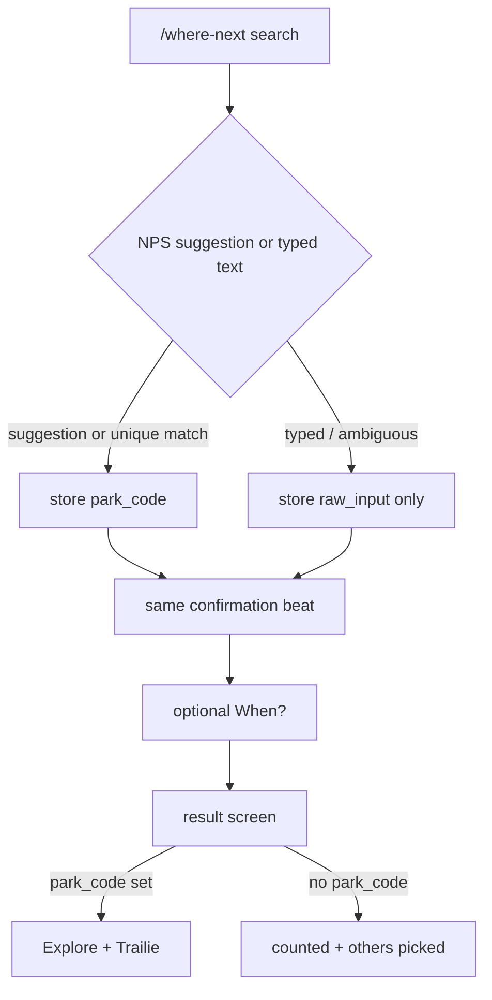

# Where Next V0

## Goal Capsule

Objective: Ship `/where-next` as a mobile-first intent capture page where any traveler can name one destination they want to visit next, optionally add a travel window, and — only when TrailVerse already has a real NPS park page — continue into Explore or Trailie.

Product authority: This plan owns the public Where Next V0 experience, its anonymous vote/intent API, cold-start ranking copy, analytics events, and the privacy-policy sentence for destination picks. V1 share cards, V2 map, V3 sitewide trending, a world destination resolver, and Google Places are not active scope.

Open blockers: None. Rank-volume thresholds below are product defaults for planning.

## Product Contract

### Summary

Where Next accepts any destination the traveler wants.
TrailVerse silently recognizes NPS catalog matches, offers Explore and Trailie only for those matches, and records everything else as travel intent without telling the user it is unsupported.

### Problem Frame

TrailVerse already has a catalog, park pages, and Trailie deep-links.
It does not have an explicit "I want to go here next" signal, and pageviews are not intent.
A global resolver and destination CMS do not exist, so the page must feel open-world without pretending Banff or Tokyo can be planned.

### Key Decisions

- Open input, silent match. `(session-settled: user-directed — chosen over NPS-only search: unmatched demand is the expansion dataset, coverage limits stay off-screen.)` Governs R2, R3, R8, R9.
- No unsupported copy. `(session-settled: user-directed — chosen over a Banff request/write-in CTA: those phrases leak internal coverage.)` Governs R8, R12.
- One active destination per session. `(session-settled: user-directed — chosen over unlimited multi-park votes: the question is where next, not a likes list.)` Governs R6.
- Fulfillment CTAs only when `park_code` is set. `(session-settled: user-directed — chosen over a generic Plan Banff chat: guest Trailie cannot honestly plan non-NPS.)` Governs R9, R10.
- Public rankings include only confidently matched NPS entities. `(session-settled: user-directed — chosen over showing raw Banff/banff canada as separate rows: free-text stays private until normalized.)` Governs R11, R13.
- No map, Places API, share cards, or sitewide badges in V0. `(session-settled: user-directed — chosen over map-first V0: participation is the experiment.)` Governs R16.
- Screen 2 confirmation is a short emotional beat before optional When?, not a coverage fork. Governs R4, R5.
- V0 does not match US state hubs or cities. Vermont typed as text is unmatched even though `/parks/state/vermont` exists. Governs R3, R9.

<!-- ce-section: work-relationships -->
### How This Work Fits Together

This plan owns **Where Next V0 — capture intent and connect matched NPS picks to existing park pages and Trailie**.
Later areas below are the current understanding, not a committed roadmap.

- V1 share / story card. Depends on V0 participation passing the pick-rate test. Enables the friend loop. Can proceed independently of a resolver.
- V2 crowd map. Depends on V1 volume. Shares the same vote store. Must not confuse with existing `/map`.
- V3 sitewide trending badges. Depends on healthy public ranking volume. Still to decide whether park pages may show ranks.
- Later non-NPS fulfillment. Depends on a destination resolver plus a page worth landing on. Shares unmatched `raw_input` demand from V0. Can proceed independently of V1 share.

### Actors

- Guest traveler (no account required).
- Optional logged-in traveler (same flow; login is not a gate).
- TrailVerse backend (match, persist active pick, rank, rate-limit).
- Existing park detail and Trailie surfaces (read-only consumers of `park_code`).

### Requirements

**Capture**

- R1. `/where-next` is a public, indexable page whose above-the-fold UI is the headline "Where do you want to go next?", short subtext, and a single search field. No map, filters, date picker, or account wall on this screen.
- R2. The traveler may type any destination string. Search suggestions come from the existing NPS catalog (`GET /api/parks/search`). The last row is always Choose "{typed text}" when the field is non-empty.
- R3. Selecting an NPS suggestion records a matched pick (`canonical_type: nps`, `park_code`, canonical name). Choosing the typed text records `raw_input` and runs silent match: attach `park_code` only when the catalog has exactly one high-confidence match for that string; if Glacier is ambiguous (Glacier vs Glacier Bay), leave it unmatched.
- R4. After a pick, show a confirmation beat with the display name ("Great pick" / "You're dreaming of {name}") and Continue. Matched and unmatched use the same layout. Do not mention coverage.
- R5. After Continue, ask When? with Fall 2026, Winter 2026–27, Spring 2027, Summer 2027, Someday / not sure, and Skip. When? is never shown before the destination pick.
- R6. One active destination per browser session. Switching replaces the active pick. Destination-changed is logged as an analytics event. V0 does not require a history table.

**Result and fulfillment**

- R7. The result screen always confirms the display name, optional travel window, and that the pick is counted.
- R8. Copy must never say unsupported, not supported, request this destination, or we couldn't find this.
- R9. If `park_code` is present, show Explore {Park} to the existing slug park page and Plan {Park} with Trailie to `/plan-ai?park={code}&name={fullName}`. If `park_code` is absent, omit both buttons. Do not invent a Banff planner CTA.
- R10. Trailie is not opened with unmatched free text in V0.
- R11. Rank language on the result screen follows volume (R14). Never invent vote counts.

**Rankings and cold start**

- R12. A below-the-fold "what others picked" area exists. In cold start it is shaping copy, not a table of tiny counts.
- R13. When public ranking is shown, rows are matched NPS destinations only. Unmatched raw strings are stored and aggregable internally, not listed as public entities.
- R14. Volume states, using sitewide active-pick count: under 50 = very early (traveler #N / shaping copy); 50–199 = some activity (soft "popular pick" language, no public numbered table); 200–999 = healthy (weekly rank for matched parks); 1000+ = large (counts allowed). No fake votes.

**Integrity, privacy, analytics**

- R15. Anonymous session id in client storage identifies the active pick. Dedicated write rate limit plus one active pick per session. Clearing storage can create a new session; accept that at V0.
- R16. V0 does not include a map, Google Places, share/story cards, destination CMS, or sitewide trending badges.
- R17. Persist raw_input, normalized_text, park_code (nullable), canonical_type (nullable), travel_window (nullable), session_id, source (nullable), created_at / updated_at.
- R18. Privacy policy states that TrailVerse stores an anonymous destination pick and optional travel window to operate Where Next and understand demand, not to sell personal information. Update the last-updated date.
- R19. Fire analytics (as `user_action` metadata actions, not eight new Analytics enum values): `where_next_view`, `where_next_search_started`, `where_next_search_query`, `where_next_destination_selected`, `where_next_destination_changed`, `where_next_destination_matched`, `where_next_destination_unmatched`, `where_next_when_selected`, `where_next_park_click`, `where_next_trailie_click`. Attributes: park_code when matched, travel_window when set, source when known. Do not put raw free-text destinations into analytics payloads.
- R20. Search stays on `/where-next`. Typing happens in the landing pill; NPS hits and Choose "{typed text}" appear under the field. Do not open a separate search page or full-screen overlay.
- R21. `source` is taken from `?src=` when present, else document referrer hostname, else null.

### Key Flows

Flow A — matched NPS (covers R2, R3, R4, R5, R7, R9, R11).
Traveler types glac → sees Glacier National Park and Glacier Bay → selects Glacier National Park → confirmation → When? Summer 2027 or Skip → result with Explore and Plan with Trailie, plus traveler-count / rank language per R14.

Flow B — unmatched free text (covers R2, R3, R7, R8, R9, R10).
Traveler types Banff → no NPS hit (or only Choose "Banff") → selects Banff → same confirmation beat → When? → result confirms Banff and that it is counted, with no Explore/Trailie, then "see what others picked" (matched public list or cold-start copy).

Flow C — ambiguous raw choose (covers R3).
Traveler types Glacier and taps Choose "Glacier" without picking a suggestion. Server does not attach a park_code. Result is unmatched Glacier. They can go back and pick Glacier National Park to match.

Flow D — change pick (covers R6).
Active pick Glacier → later Japan. Japan is the only active vote. Glacier is no longer counted in rankings. `where_next_destination_changed` fires.

Flow E — cold-start landing (covers R1, R12, R14).
Visitor with under 50 sitewide picks sees headline + search. Below the fold: "Help shape the first TrailVerse travel list." No numbered leaderboard.

### Acceptance Examples

- AE1. Given Banff with no catalog match, when the traveler confirms, then the UI never contains the substrings unsupported, not supported, couldn't find, or request this destination, and Explore/Trailie are absent. Covers R8, R9.
- AE2. Given a tap on Glacier National Park from search, when the result renders, then Explore links to `/parks/glacier-national-park` and Trailie to `/plan-ai?park=glac&name=Glacier%20National%20Park`. Covers R9.
- AE3. Given 12 sitewide active picks, when any visitor opens `/where-next`, then no public table of ranks with counts is shown. Covers R14.
- AE4. Given existing votes "Banff", "banff canada", and "Banff National Park", when public rankings are eligible, then those three strings do not appear as three rows. Covers R13.
- AE5. Given a session that picked Yosemite then switches to Italy, when stats are computed, then Yosemite is not counted for that session and Italy is. Covers R6.
- AE6. Given typed Vermont with no NPS entity selected, when the result renders, then no state-hub Explore button is shown. Covers R3, R9.

### Success Criteria

For the first 100 real `/where-next` visitors:

- Destination-pick rate: hypothesis 30+ (matched + unmatched both count).
- When? completion among pickers (informational, no gate).
- Match rate among picks (how much demand the NPS catalog absorbs).
- Combined Explore + Trailie CTR among matched picks.
- At least one Trailie user message among Trailie clickers (join existing `ai_chat`, not a new planner).

Do not judge the experiment as failed solely because many picks are unmatched.

### Scope Boundaries

Deferred for later: share/story cards, friend `?` inbound loop, map, public free-text leaderboard after human/admin normalization, state-hub matching, sitewide trending, destination CMS, Google/Apple login, custom Trailie welcome beyond the existing park deep-link.

Outside this product's identity: a global travel planner, fake Plan Banff, fake vote counts, exposing coverage gaps in copy.

V0 inbound marketing: no homepage hero takeover. A single quiet footer or homepage text link is allowed but not required to ship.

### Dependencies / Assumptions

- NPS search and park slugs already work (`npsApi.searchParks`, `parkToSlug`).
- Trailie already accepts `/plan-ai?park=&name=`.
- Guest Trailie remains 5 messages / 48h with no web search; that is why unmatched destinations do not open Trailie.
- Privacy policy page is editable in `next-frontend/src/app/privacy/PrivacyPageClient.jsx`.

### Outstanding Questions

Resolved in `docs/superpowers/plans/2026-08-27-where-next-v0.md`: session key `trailverse_where_next_session`; 20 writes / 15 min / IP; optional `userId` when cookie present; in-page steps not nested routes.

### Sources / Research

- Prior audit: open-world voting without fulfillment is a toy; this spec keeps open input but withholds fake CTAs.
- Incumbents: `/explore`, `/parks/{slug}`, `/plan-ai?park=`, `GET /api/parks/search`.
- Privacy: destination + travel window + session id is purpose-limited personal data; R18 is the product response.
