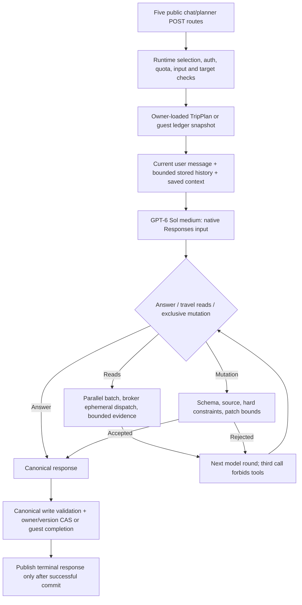

# Current local runtime flow

Baseline: current working files on September 30, 2026; HEAD alone does not contain the complete implementation. [server/src/config/trailieRuntimeSelection.js:1 (local)](../../server/src/config/trailieRuntimeSelection.js) forces production to legacy, defaults nonproduction to model_first, permits explicit legacy rollback, and rejects invalid selection.

## Admission and provider

The router intercepts `/chat`, `/chat-stream`, `/chat-anonymous`, `/chat-anonymous-stream`, and `/plan-itinerary` before legacy handlers. It checks message size (30,000 characters), metadata size (50,000 bytes), optional day scope, authenticated owner, quota, and selected trip. A different `targetTripId` is rejected rather than silently redirecting writes. Only after loading the snapshot are paid-provider dependencies constructed. [server/src/routes/modelFirstTrailie.js:19 (local)](../../server/src/routes/modelFirstTrailie.js).

`createSimpleModel` defaults to `MODEL_ROUTES.SOL_MEDIUM`: `gpt-6-sol`, medium reasoning, maximum 10,000 output tokens. SDK retries are zero; client timeout is 180 seconds. No automatic Luna/Astra escalation or Claude fallback is called on this path. The existence of the broader router does not make it active here. Responses function-call items and outputs are preserved natively between rounds; function schemas use `strict:false`. [server/src/services/trailieSimpleModel.js:15 (local)](../../server/src/services/trailieSimpleModel.js); [server/src/config/trailieModelRouter.js:5 (local)](../../server/src/config/trailieModelRouter.js).

## Context and tools

History is authoritative stored history, not arbitrary client transcript: last 40 eligible user/assistant messages, 24,000 characters total, 12,000 per message. The current message is appended separately. Instructions include date/time, full saved plan, full trip `planningState`, authorized edit scope, and request form/entry context. Saved plan and memory have no explicit serialized-size cap in this builder. Client body `systemPrompt`, arbitrary `metadata.aiContext`, and the production user-profile enrichment are not forwarded. [server/src/services/trailieSimpleRuntime.js:37 (local)](../../server/src/services/trailieSimpleRuntime.js).

Two model tools exist:

- `read_travel`: model chooses one of 12 providers and one of 31 topic codes, with entity/time/route/provenance details.
- `propose_trip_update`: answer plus typed memory and/or plan/patch; it cannot share a tool batch with research.

Reads batch in parallel, but a batch sees only evidence from previous batches. Evidence starts empty per turn. Output retains at most 8 evidence rows and 12,000 bytes of evidence per read, plus wrapper fields. Provider status is returned unchanged even if topic/freshness filtering removes every row. [server/src/services/trailieSimpleTools.js:1 (local)](../../server/src/services/trailieSimpleTools.js).

## Completion and failure

Default cap is 3 model attempts and 12 executed reads. Final model call is prose-only. Any nonfulfilled tool result or reaching the tool cap forces the next call into synthesis-only mode. One rejected mutation may be corrected, but only if a tool-enabled slot remains. A proposal rejected on call 2 cannot be corrected as a mutation on call 3. Research failure therefore also suppresses independent memory/plan writes, not just further research. [server/src/services/trailieSimpleRuntime.js:81 (local)](../../server/src/services/trailieSimpleRuntime.js).

A normal prose answer saves conversation but does not update typed memory or create a plan. Accepted mutations are validated before commit. Authentication/ownership, schema, current-turn quotes, dates, retrieved stop identity, routes, hard mobility constraints and untouched-day checks protect state. These do not prove a good travel experience or semantic entailment of quotes. The mutation response field has an implicit 2,000-character guard limit through `typed(...,'string')`, not advertised as `maxLength` in its tool schema. [server/src/services/trailieSimpleGuard.js:92 (local)](../../server/src/services/trailieSimpleGuard.js).

The route is SSE-shaped but model generation itself is nonstreaming. It emits start/keepalive, then all content and final response after persistence. Failure becomes a bounded error with `retryable:false`; the web client recognizes the runtime header and avoids automatic legacy fallback. No early canonical itinerary checkpoint or token stream exists on this path. [server/src/routes/modelFirstTrailie.js:111 (local)](../../server/src/routes/modelFirstTrailie.js); [next-frontend/src/services/aiService.js:87 (local)](../../next-frontend/src/services/aiService.js).

## What is intentionally bypassed

The September local legacy pipeline's intent classifier, traveler-job resolver, sufficiency gates, pre-model phrase mutations, artifact arbitration, semantic day-value grading and multi-family repair orchestration are not the active turn path. Core canonical contracts, selected hard-constraint helpers, providers and frontend components are reused. Do not attribute the old local pipeline's every defect or test result to this simple runtime. The cutover's [reachability report](../../artifacts/trailie-model-first-cutover-2026-09-30/legacy-reachability.md) agrees with the router trace.

The cutover report explicitly says no live post-cutover request verified the running process. This audit also made none. “Current local” here is the current on-disk runtime and its default route selection.
