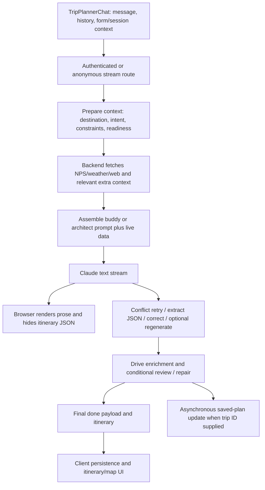

# Production runtime flow

Scope: frontend and backend commit `324faaaf68334db41ded82b8d8c777f6fd5de76a`, verified from deployed metadata in [the audit](TRAILIE_PROD_VS_LOCAL_AUDIT.md). Do not substitute current `ai.js` or current local legacy code for this August implementation.

## Normal website streaming chat

### Request and context

The client sends recent conversation messages, `systemPrompt` session context, metadata/form data and trip identity. Its session context includes a readable current itinerary. Backend `prepareChatContext` auto-selects provider (`TRAILIE_DEFAULT_PROVIDER` or Claude), resolves response mode independently of provider, extracts constraints/destinations, and builds readiness/preflight information. A specific itinerary selects the **architect prompt even when the provider is Claude**; buddy and comparison use the Claude overlay. [server/src/utils/trailieResponseMode.js:26 (production)](https://github.com/KrishnaSathvik/TrailVerse/blob/324faaaf68334db41ded82b8d8c777f6fd5de76a/server/src/utils/trailieResponseMode.js#L26); [server/src/routes/ai.js:701 (production)](https://github.com/KrishnaSathvik/TrailVerse/blob/324faaaf68334db41ded82b8d8c777f6fd5de76a/server/src/routes/ai.js#L701).

Long histories over 20 messages keep the latest 15 nonsystem messages and build a heuristic older-user summary. Caveat: the generated summary is stored as a system message, then system messages are removed from the conversation. Explicit body `systemPrompt` takes precedence in session-context extraction, so this generated summary is not reliably carried as session context when the client supplies its own context. Independently extracted original conversation summary/form/saved metadata still feed trip state. This is not a robust semantic memory mechanism. [server/src/routes/ai.js:469 (production)](https://github.com/KrishnaSathvik/TrailVerse/blob/324faaaf68334db41ded82b8d8c777f6fd5de76a/server/src/routes/ai.js#L469); [server/src/routes/ai.js:753 (production)](https://github.com/KrishnaSathvik/TrailVerse/blob/324faaaf68334db41ded82b8d8c777f6fd5de76a/server/src/routes/ai.js#L753).

Authenticated profile context includes up to 10 favorites and 10 visited parks, with explicit Known/Unknown framing. It can be skipped and returns empty without the expected user identity/name. Trip state merges profile-derived context, saved form, conversation summary, current form, and current-message interpretations, in that order. [server/src/routes/ai.js:1567 (production)](https://github.com/KrishnaSathvik/TrailVerse/blob/324faaaf68334db41ded82b8d8c777f6fd5de76a/server/src/routes/ai.js#L1567); [server/src/utils/tripStateBuilder.js:334 (production)](https://github.com/KrishnaSathvik/TrailVerse/blob/324faaaf68334db41ded82b8d8c777f6fd5de76a/server/src/utils/tripStateBuilder.js#L334).

### Retrieval

Retrieval happens **before generation**: `fetchRelevantFacts` schedules relevant NPS/weather/web/astronomy/fee-free work; multiple parks' NPS facts are fetched in parallel. Additional discovery, road, driving and imagery work can occur in context preparation. This is one orchestration phase, not one HTTP request. NPS facts condense park details, alerts, campgrounds, visitor centers and permits. Web uses category-selected providers, a 15-minute in-memory cache, primary-first search and bounded backup providers when results are insufficient. [server/src/routes/ai.js:1008 (production)](https://github.com/KrishnaSathvik/TrailVerse/blob/324faaaf68334db41ded82b8d8c777f6fd5de76a/server/src/routes/ai.js#L1008); [server/src/services/factsService.js:271 (production)](https://github.com/KrishnaSathvik/TrailVerse/blob/324faaaf68334db41ded82b8d8c777f6fd5de76a/server/src/services/factsService.js#L271); [server/src/services/factsService.js:673 (production)](https://github.com/KrishnaSathvik/TrailVerse/blob/324faaaf68334db41ded82b8d8c777f6fd5de76a/server/src/services/factsService.js#L673).

Ordinary guests skip web; trusted MCP is an explicit exception in `skipWebSearchForGuest`. Named non-NPS authenticated questions can use web. Facts, availability manifests, constraints and structured context are inserted into the prompt; the model is not responsible for discovering provider/topic combinations. Failures usually preserve a general answer path. Retrieval gates can also omit useful information, and no-data does not prove absence.

### Model and postprocessing

Source primary is `claude-sonnet-5`; fallback list adds `claude-sonnet-4-6` and `claude-haiku-4-5-20251001`; extraction defaults to that Haiku identifier; reviewer defaults to primary. Environment values can override these. Exact live model aliases/snapshots are not established by deployment metadata. [server/src/config/aiModels.js:1 (production)](https://github.com/KrishnaSathvik/TrailVerse/blob/324faaaf68334db41ded82b8d8c777f6fd5de76a/server/src/config/aiModels.js#L1).

The SSE helper makes one text-stream generation request with no tools. It omits temperature for Sonnet/Opus 5 identifiers. It does **not** use the nonstream model-fallback loop and leaves usage null. [server/src/services/aiProviderStream.js:1 (production)](https://github.com/KrishnaSathvik/TrailVerse/blob/324faaaf68334db41ded82b8d8c777f6fd5de76a/server/src/services/aiProviderStream.js#L1).

After generation, the shared processor can run: one conflict retry, one missing-JSON extraction, one aggressive-correction regeneration, one review, and one repair. These are conditional additional calls; no universal one-call claim is valid. Although a constant initially disables stream regeneration, the stream route overrides it with `userRequestedItinerary`. Driving enrichment has a 2.5-second response wait cap; its Promise.race is not proof of cancellation. [server/src/routes/ai.js:1980 (production)](https://github.com/KrishnaSathvik/TrailVerse/blob/324faaaf68334db41ded82b8d8c777f6fd5de76a/server/src/routes/ai.js#L1980); [server/src/routes/ai.js:2770 (production)](https://github.com/KrishnaSathvik/TrailVerse/blob/324faaaf68334db41ded82b8d8c777f6fd5de76a/server/src/routes/ai.js#L2770).

Reviewer/repair still pass temperature unconditionally. The reviewer catches request errors and returns passed=true. Existing Render errors corroborate this production weakness; see [latency/cost](LATENCY_COST_COMPARISON.md). [server/src/services/trailieReviewerService.js:200 (production)](https://github.com/KrishnaSathvik/TrailVerse/blob/324faaaf68334db41ded82b8d8c777f6fd5de76a/server/src/services/trailieReviewerService.js#L200).

### Persistence and rendering

Streaming text is visible before corrections/review and before durable persistence. `done` can replace it and carries the itinerary. Authenticated stream handling launches `void saveStreamItineraryToTrip`; the helper updates by trip ID without an owner predicate or compare-and-swap at that write. Client auto-save is another writer. This is a source-level ownership/race weakness, not a claim that exploitation or data loss was observed. [server/src/routes/ai.js:571 (production)](https://github.com/KrishnaSathvik/TrailVerse/blob/324faaaf68334db41ded82b8d8c777f6fd5de76a/server/src/routes/ai.js#L571); [server/src/routes/ai.js:2805 (production)](https://github.com/KrishnaSathvik/TrailVerse/blob/324faaaf68334db41ded82b8d8c777f6fd5de76a/server/src/routes/ai.js#L2805); [next-frontend/src/components/plan-ai/TripPlannerChat.jsx:1892 (production)](https://github.com/KrishnaSathvik/TrailVerse/blob/324faaaf68334db41ded82b8d8c777f6fd5de76a/next-frontend/src/components/plan-ai/TripPlannerChat.jsx#L1892).

Anonymous flows use AnonymousSession and limits; they are not equivalent to authenticated TripPlan persistence. Client stream error handling can fall back to nonstream, introducing another request outside the backend call-count model.

## Other routes must not be conflated

- `/chat` and `/chat-anonymous`: nonstream Claude fallback loop; architect planning can expose `create_itinerary` as an output tool. It is not a research-agent loop. [server/src/utils/trailiePipelineUtils.js:42 (production)](https://github.com/KrishnaSathvik/TrailVerse/blob/324faaaf68334db41ded82b8d8c777f6fd5de76a/server/src/utils/trailiePipelineUtils.js#L42).
- `/plan-itinerary`: separate `fastItineraryPlannerService`, park-data-driven construction with lightweight narrative refinement and an 8-second wait cap; not the above Claude streaming pipeline. [server/src/services/fastItineraryPlannerService.js:374 (production)](https://github.com/KrishnaSathvik/TrailVerse/blob/324faaaf68334db41ded82b8d8c777f6fd5de76a/server/src/services/fastItineraryPlannerService.js#L374).
- Voice and external MCP deployment are separate execution surfaces. This audit traces website Trailie and its shared planner route; it does not claim the MCP service's production revision equals the web backend revision.
